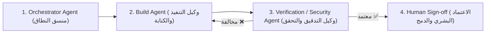

# PainVisual AI Operating Manual & Workflow

## دليل حوكمة وتشغيل وكلاء الذكاء الاصطناعي (AI Operating Manual & Governance Workflow)
### مشروع: تطبيق الاستشارات الطبية — وصف الألم بالنموذج التفاعلي
**الشعار والموقف الإرغونومي:** «الألم يُرى ولا يُوصف بالكلمات»  
**الوثيقة:** الدليل الإلزامي لتشغيل وتوجيه وتدقيق وكلاء الذكاء الاصطناعي أثناء التنفيذ البرمجي (AI Workflow)  
**الإصدار:** 1.0 — MVP نوفمبر 2026  
**المراجع الحاكمة:**
- [cahier_charge.md](file:///c:/Users/MO/Desktop/ai-drive/cahier_charge.md) (مرجع الهيكل والتنظيم والموقف الإرغونومي)
- [architecture.md](file:///c:/Users/MO/Desktop/ai-drive/New%20files/architecture.md) (المعمارية المرجعية وقواعد البيانات)
- [api-contract.md](file:///c:/Users/MO/Desktop/ai-drive/New%20files/api-contract.md) (عقد واجهات الـ REST العشرين)
- [backend-plan.md](file:///c:/Users/MO/Desktop/ai-drive/New%20files/backend-plan.md) (خطة الواجهة الخلفية والخدمات)
- [frontend-plan.md](file:///c:/Users/MO/Desktop/ai-drive/New%20files/frontend-plan.md) (خطة الواجهة الأمامية والشاشات السبع)
- [infra-plan.md](file:///c:/Users/MO/Desktop/ai-drive/New%20files/infra-plan.md) (خطة البنية التحتية وحماية البيانات)
- [master-plan.md](file:///c:/Users/MO/Desktop/ai-drive/New%20files/master-plan.md) (خطة التنفيذ الرئيسية ومراحل المصافحة)
- [Agents.md](file:///c:/Users/MO/Desktop/ai-drive/Agents.md) (محددات وقواعد وكيل التحقق Verification Agent)

---

## فهرس المحتويات (Table of Contents)

1. [الهدف ودستور التشغيل الآلي (Purpose & AI Operating Charter)](#1-الهدف-ودستور-التشغيل-الآلي-purpose--ai-operating-charter)
2. [أدوار ومسؤوليات وكلاء الذكاء الاصطناعي (AI Agent Roles)](#2-أدوار-ومسؤوليات-وكلاء-الذكاء-الاصطناعي-ai-agent-roles)
3. [بروتوكول تحميل السياق المرجعي (Context Loading Protocol)](#3-بروتوكول-تحميل-السياق-المرجعي-context-loading-protocol)
4. [دورة عمل وكيل التنسيق (Orchestrator Agent Workflow)](#4-دورة-عمل-وكيل-التنسيق-orchestrator-agent-workflow)
5. [قواعد التنفيذ لوكيل البناء (Build Agent Strict Execution Rules)](#5-قواعد-التنفيذ-لوكيل-البناء-build-agent-strict-execution-rules)
6. [دورة التحقق والتدقيق الأمني (Review & Security Audit Workflow)](#6-دورة-التحقق-والتدقيق-الأمني-review--security-audit-workflow)
7. [قواعد مكافحة الهلوسة ومنع الابتداع (Anti-Hallucination & Scope Defense)](#7-قواعد-مكافحة-الهلوسة-ومنع-الابتداع-anti-hallucination--scope-defense)
8. [بوابات المصادقة البشرية ونقاط التصعيد (Human Approval Gates & Escalation)](#8-بوابات-المصادقة-البشرية-ونقاط-التصعيد-human-approval-gates--escalation)
9. [إدارة التغيير والتراجع الآمن (Change Control & Safe Rollback)](#9-إدارة-التغيير-والتراجع-الآمن-change-control--safe-rollback)
10. [قوالب توجيه المهام النموذجية (Prompt Templates for AI Agents)](#10-قوالب-توجيه-المهام-النموذجية-prompt-templates-for-ai-agents)

---

## 1. الهدف ودستور التشغيل الآلي (Purpose & AI Operating Charter)

يمثل هذا الملف الدليل التشغيلي الإلزامي الحاكم لجميع وكلاء الذكاء الاصطناعي (AI Agents) والمطورين عند كتابة أو تعديل أو تدقيق الكود البرمجي لمشروع **PainVisual**.

### الدستور الثلاثي للـ AI Agents:
1. **الوثائق هي المصدر الأعلى للحقيقة (Specifications are the Single Source of Truth):** لا يجوز لأي وكيل افتراض متطلبات غير مكتوبة في [cahier_charge.md](file:///c:/Users/MO/Desktop/ai-drive/cahier_charge.md) أو ابتداع مسارات غير موثقة في [api-contract.md](file:///c:/Users/MO/Desktop/ai-drive/New%20files/api-contract.md).
2. **منع تسرّب المشروعات السابقة (Zero Prior-Project Leakage):** يُحظر حظراً تاماً نقل أي كيانات أو مفاهيم تجارية أو بيعية من المشروع السابق (ShopManager) مثل المنتجات، الفواتير، الديون، أو نقاط البيع.
3. **احترام الحدود السريرية والإرغونومية (Ergonomic & Clinical Boundary Protection):** الالتزام الصارم بشعار «الألم يُرى ولا يُوصف بالكلمات»؛ والتأكيد على أن التطبيق أداة تواصل ووصف بصري سريري وليس محرك تشخيص طبي ذكي.

---

## 2. أدوار ومسؤوليات وكلاء الذكاء الاصطناعي (AI Agent Roles)

يعتمد النظام نموذج عمل ثلاثي الأركان منضبط ومحكم:



### 2.1 وكيل التنسيق وإدارة النطاق (Orchestrator Agent)
- **المسؤولية:** قراءة وثائق [master-plan.md](file:///c:/Users/MO/Desktop/ai-drive/New%20files/master-plan.md) و [architecture.md](file:///c:/Users/MO/Desktop/ai-drive/New%20files/architecture.md)، وتحديد المرحلة الحالية (من 1 إلى 5)، وضبط نطاق المهمة بدقة، وتحديد الملفات المسموح بتعديلها والملفات المحظور لمسها، ومنع تجاوز حدود المرحلة.

### 2.2 وكيل البناء والتنفيذ (Build Agent)
- **المسؤولية:** كتابة الأكواد البرمجية (سواء في الخلفية أو الواجهة أو إعدادات البنية التحتية) حصرياً ضمن النطاق المصرح به من قبل الـ Orchestrator، والالتزام الحرفي بنماذج البيانات والغلاف القياسي وعقد الـ API.

### 2.3 وكيل التحقق والمراجعة الأمنية (Verification & Security Agent)
- **المسؤولية:** وكيل تدقيق ومراجعة للقراءة فقط (Read-Only Auditor) طبقاً لمواصفات [Agents.md](file:///c:/Users/MO/Desktop/ai-drive/Agents.md). يقوم بفحص الكود بعد انتهاء كتابته، واكتشاف أي انحراف عن العقد (Contract Drift)، أو تسرب مفاهيم غير مصرح بها، أو خرق لقواعد الخصوصية الصحية.

---

## 3. بروتوكول تحميل السياق المرجعي (Context Loading Protocol)

قبل أن يبدأ أي وكيل ذكاء اصطناعي بتنفيذ أي مهمة برمجية، **يجب عليه إلزامياً قراءة الملفات المرجعية المحددة وفق الجدول التالي:**

| نوع المهمة البرمجية | الملفات الإلزامية التي يجب قراءتها قبل البدء |
|---|---|
| **تطوير أي شاشة لمسية في الواجهة** | 1. [cahier_charge.md](file:///c:/Users/MO/Desktop/ai-drive/cahier_charge.md) (أهداف الشاشة والعناصر)<br>2. [frontend-plan.md](file:///c:/Users/MO/Desktop/ai-drive/New%20files/frontend-plan.md) (مواصفات المكونات وحجم اللمس $\ge 48$px)<br>3. [api-contract.md](file:///c:/Users/MO/Desktop/ai-drive/New%20files/api-contract.md) (النقاط المرتبطة بالشاشة)<br>4. [master-plan.md](file:///c:/Users/MO/Desktop/ai-drive/New%20files/master-plan.md) (شروط مصافحة المرحلة) |
| **تطوير مسار أو خدمة في الخلفية** | 1. [backend-plan.md](file:///c:/Users/MO/Desktop/ai-drive/New%20files/backend-plan.md) (قواعد الخدمة ونماذج Prisma)<br>2. [api-contract.md](file:///c:/Users/MO/Desktop/ai-drive/New%20files/api-contract.md) (هيكل الطلب والاستجابة ومخططات Zod)<br>3. [architecture.md](file:///c:/Users/MO/Desktop/ai-drive/New%20files/architecture.md) (قواعد الخصوصية والتشفير) |
| **تعديل في قاعدة البيانات أو التخزين** | 1. [architecture.md](file:///c:/Users/MO/Desktop/ai-drive/New%20files/architecture.md) (نماذج الجلسات وسجلات الألم)<br>2. [infra-plan.md](file:///c:/Users/MO/Desktop/ai-drive/New%20files/infra-plan.md) (سياسة التخزين المؤقت والحذف التلقائي) |
| **التدقيق والمراجعة (Verification)** | 1. [cahier_charge.md](file:///c:/Users/MO/Desktop/ai-drive/cahier_charge.md)<br>2. [Agents.md](file:///c:/Users/MO/Desktop/ai-drive/Agents.md)<br>3. الكود البرمجي المعدل أو المضاف حديثاً |

---

## 4. دورة عمل وكيل التنسيق (Orchestrator Agent Workflow)

عند استلام أي طلب من المستخدم أو المهندس البشري:
1. **قراءة الحالة الراهنة:** فحص [master-plan.md](file:///c:/Users/MO/Desktop/ai-drive/New%20files/master-plan.md) وتحديد رقم المرحلة الحالية ونقاط المصافحة المعلقة.
2. **تصنيف المهمة:** تصنيف نوع المهمة:
   `session | pain_telemetry | audio_memo | visual_report | doctor_portal | cron_jobs | infra`
3. **تحديد النطاق الحصري:** صياغة قائمة محددة بالملفات المسموح بتعديلها والملفات المحظور مساسها لمنع التداخل بين الوحدات.
4. **توجيه وكيل البناء (Build Agent):** صياغة التوجيه الحصري المتوافق مع نموذج الـ Prompt في القسم 10.
5. **استلام المخرجات وإحالتها للتدقيق:** تحويل الملفات الناتجة فوراً لوكيل التحقق دون دمجها مباشرة في الفرع الرئيسي.

---

## 5. قواعد التنفيذ لوكيل البناء (Build Agent Strict Execution Rules)

يجب على **Build Agent** الالتزام الصارم بالقواعد التالية أثناء كتابة الكود:

### ما يجب فعله إلزامياً (MUST DO):
- إعادة تأكيد نطاق المهمة والمرحلة الحالية وقائمة الملفات قبل البدء في كتابة أي كود.
- الالتزام التام بعقد الواجهات في [api-contract.md](file:///c:/Users/MO/Desktop/ai-drive/New%20files/api-contract.md)؛ لا تعديل في مسميات الحقول أو أنواعها أو رموز الأخطاء.
- استخدام عميل الـ API المركزي الموحد في الواجهة الأمامية (`apiClient.ts`)؛ حظر استخدام `fetch` المباشر.
- حصر قواعد الأعمال السريرية داخل الخدمات (Services) في الواجهة الخلفية؛ إبقاء المتحكمات (Controllers) نحيفة وخالية من المنطق الحسابي المعقد.
- الحفاظ على استجابة الواجهة اللمسية بمعدل 60 إطاراً في الثانية (60fps) ومنع أي حجب لواجهة المستخدم (Non-blocking UI).
- الالتزام الصارم بالحد الأقصى للتسجيل الصوتي (45 ثانية وحجم 10 ميغابايت).
- التوقف الفوري وطلب الاستشارة إذا تطلبت المهمة تعديل ملفات خارج النطاق المصرح به.

### ما يُحظر فعله قطيعاً (MUST NOT):
- **حظر تام لاختراع الحقول أو المسارات:** لا يُسمح بابتداع أي Endpoint أو حقل DTO أو رمز خطأ أو متغير بيئة غير مسجل في الوثائق المرجعية.
- **حظر الاستمارات النصية الطويلة في الواجهة:** منع إضافة أي حقول نصية إلزامية لوصف الألم، التزاماً بالموقف الإرغونومي «الألم يُرى ولا يُوصف بالكلمات».
- **حظر انتهاك الخصوصية الصحية:** منع حفظ أي بيانات تعريفية بالاسم أو بطاقات الهوية؛ الجلسات مجهولة الهوية مشفرة بـ `sessionToken`.
- **حظر تعديل قواعد العقد بصمت:** لا يجوز تغيير نوع بيانات في الـ Schema أو تعديل مسار إلا عبر تذكرة رسمية لتحديث [api-contract.md](file:///c:/Users/MO/Desktop/ai-drive/New%20files/api-contract.md).
- **حظر خلط المهام والمراحل:** لا يجوز تنفيذ جزء من المرحلة 4 أثناء العمل على المرحلة 2.

---

## 6. دورة التحقق والتدقيق الأمني (Review & Security Audit Workflow)

يعمل **Verification Agent** وفقاً للتعليمات الصارمة الواردة في [Agents.md](file:///c:/Users/MO/Desktop/ai-drive/Agents.md):
- هو وكيل تدقيق ومراجعة فقط؛ **لا يقوم بتعديل الأكواد بنفسه**.
- يقوم بفحص الكود وفق المعايير الأربعة:
  1. **المطابقة الهيكلية (`cahier_charge.md`):** التحقق من الشاشات السبع، والأبعاد الستة للألم، والوظائف F1–F8، والموقف الإرغونومي.
  2. **مطابقة المحتوى الفعلي:** التحقق من التزام الرموز الحسية الخمسة (وخز، حرقان، نبض، طعن، ثقل) والحركات الخمس (انحناء، رفع ذراع، مشي، جلوس، التواء) دون تحريف.
  3. **الاتساق الداخلي:** التأكد من مطابقة الكود المنفذ مع [api-contract.md](file:///c:/Users/MO/Desktop/ai-drive/New%20files/api-contract.md) و [architecture.md](file:///c:/Users/MO/Desktop/ai-drive/New%20files/architecture.md).
  4. **منع تسرب المشروعات السابقة:** التأكد من خلو الكود تماماً من أي آثار لـ ShopManager.
- يُصدر تقريراً رسمياً يتضمن الحكم الصريح:
  - ✅ **PASS:** الكود مطابق بالكامل وجاهز للدمج.
  - ⚠️ **PASS WITH NOTES:** الكود مطابق مع ملاحظات طفيفة لا تعيق النشر.
  - ❌ **FAIL:** الكود يحتوي على خرق للعقد أو هلوسة أو اختراع متطلبات، ويجب إعادته فوراً لـ Build Agent لإصلاحه.

---

## 7. قواعد مكافحة الهلوسة ومنع الابتداع (Anti-Hallucination & Scope Defense)

عندما يواجه الـ AI Agent نقصاً في معلومة أو حالة استثنائية:
1. **ممنوع الاختراع البرمجي:** لا يجوز سد النقص بتوليد حقول أو ميزات وهمية ثم بناء منطق النظام عليها.
2. **سلسلة البحث المنهجي:**
   - البحث في [cahier_charge.md](file:///c:/Users/MO/Desktop/ai-drive/cahier_charge.md) أولاً.
   - التحقق من تفاصيل العقد في [api-contract.md](file:///c:/Users/MO/Desktop/ai-drive/New%20files/api-contract.md) والمعمارية في [architecture.md](file:///c:/Users/MO/Desktop/ai-drive/New%20files/architecture.md).
3. **تسجيل الافتراض (Assumption Protocol):** إذا كانت المعلومة غير محددة وكان القرار ضرورياً لمتابعة الكود:
   - يُسجل القرار كـ **Assumption** موثق في ملف التقرير.
   - لا يجوز تحويل هذا الافتراض إلى متطلب رسمي أصلي دون موافقة المطور البشري.
4. **تسجيل السؤال المفتوح (Open Question):** إذا ترتب على القرار تأثير سريري أو معماري، يتوقف الوكيل فوراً ويُسجل **Open Question** للمراجعة البشرية.

---

## 8. بوابات المصادقة البشرية ونقاط التصعيد (Human Approval Gates & Escalation)

يجب على جميع وكلاء الذكاء الاصطناعي التوقف فوراً وطلب المصادقة البشرية الصريحة (Escalation to Human) في الحالات التالية:
- أي اقتراح لتعديل مسار أو حمولة في عقد الـ API ([api-contract.md](file:///c:/Users/MO/Desktop/ai-drive/New%20files/api-contract.md)).
- أي تغيير في هيكل الجداول أو الفهارس في قاعدة البيانات.
- أي تعديل في سياسات الأمان أو آليات تشفير الصوت أو فترات انتهاء الجلسات (6 ساعات) والتقارير (48 ساعة).
- محاولة إضافة حزمة برمجية جديدة (New npm package) خارج الحزم المعتمدة في خطط التنفيذ.
- فشل فحص المصافحة (Handshake Checkpoint) عند محاولة إغلاق مرحلة من مراحل الـ Master Plan.

---

## 9. إدارة التغيير والتراجع الآمن (Change Control & Safe Rollback)

1. **انضباط طلبات الدمج (One Task = One Branch / PR):**
   - تُنفذ كل مهمة من مهام الـ Master Plan في فرع برمجي مستقل (مثل `feat/phase2-location-canvas` أو `feat/phase4-audio-vault`).
2. **بروتوكول التراجع الفوري (Safe Rollback Protocol):**
   - في حال صدور حكم ❌ **FAIL** من Verification Agent ولم يتمكن Build Agent من معالجته في محاولتين متتاليتين، يتم التراجع الفوري عن التغييرات (`git checkout -- .`) واستعادة آخر حالة مستقرة للمرحلة، وإخطار المهندس البشري بتفاصيل العائق.

---

## 10. قوالب توجيه المهام النموذجية (Prompt Templates for AI Agents)

### قالب توجيه مهمة بناء (Build Task Prompt Template)
```markdown
### TASK SPECIFICATION FOR BUILD AGENT
- **المهمة:** <اسم المهمة البرمجية المحددة>
- **المرحلة الحاكمة في Master Plan:** <المرحلة من 1 إلى 5>
- **المكون المستهدف:** <واجهة Frontend / خادم Backend / بنية تحتية Infra>

**المراجع الإلزامية للقراءة قبل كتابة سطر كود واحد:**
1. docs/master-plan.md (شروط مصافحة المرحلة المحددة)
2. docs/architecture.md (القسم المعماري المرتبط بالمهمة)
3. docs/api-contract.md (المسارات المحددة وحقول DTO الدقيقة)
4. docs/frontend-plan.md أو docs/backend-plan.md (حسب التخصص)

**النطاق المسموح به (Allowed Files):**
- <قائمة بالملفات التي يُسمح بإنشائها أو تعديلها حصراً>

**الملفات المحظور لمسها (Forbidden Files):**
- <قائمة بالملفات الحساسة المحظورة>

**القواعد والاشتراطات الصارمة:**
- لا تخترع أي حقل أو Endpoint غير موجود في API-Contract.md.
- لا تضع أي استمارات نصية مطولة في الواجهة (الموقف الإرغونومي: الألم يُرى ولا يُوصف).
- التزم بتشغيل الكود بنمط TypeScript الصارم وعدم حجب الواجهة (60fps).
- عند الانتهاء، قدم قائمة بالملفات المعدلة وخطوات الفحص لمطابقتها مع Verification Agent.
```

---

> **خاتمة:**  
> يضمن هذا الدليل التشغيلي والحوكمي قيادة وكلاء الذكاء الاصطناعي بكفاءة متناهية، ويمنع الهلوسة وانحراف النطاق، ويحافظ على أمان البيانات الصحية والموقف الإرغونومي الثوري لتطبيق **PainVisual** حتى الوصول للإطلاق السحابي الناجح للمشروع.
