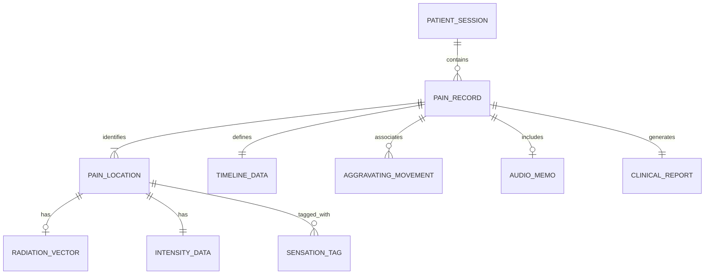
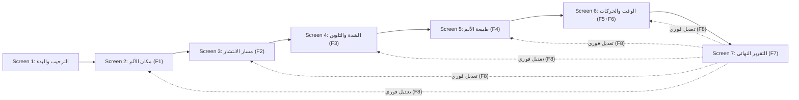
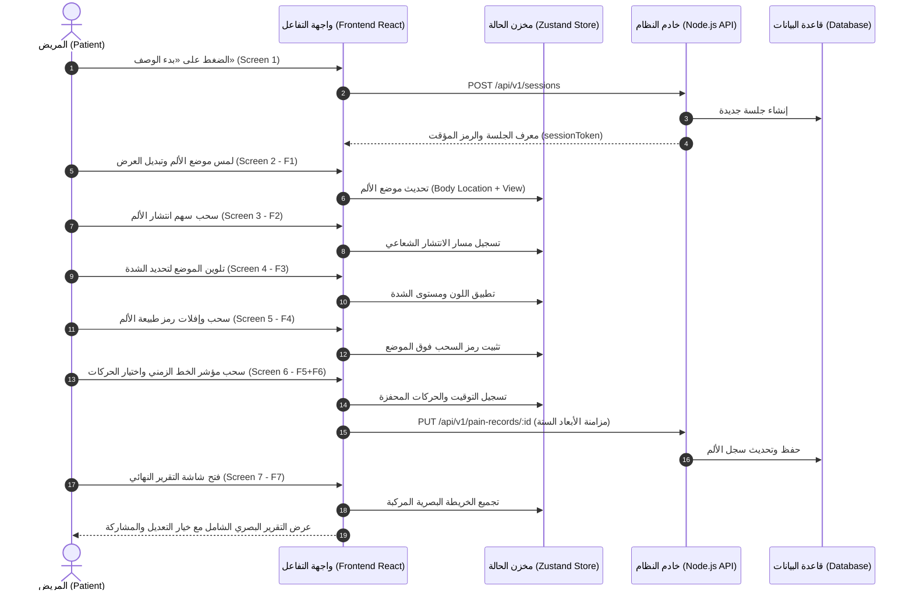
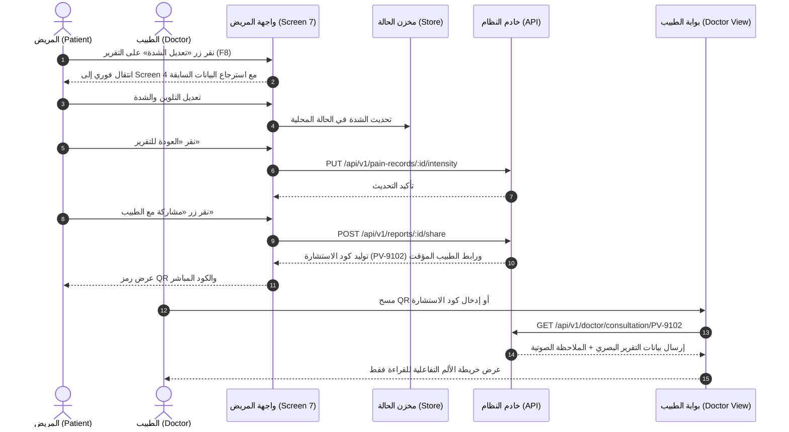

# Architecture Technique & System Design — PainVisual (AI Specen Drive)

## تطبيق الاستشارات الطبية — وصف الألم بالنموذج التفاعلي
### الشعار والموقف الإرغونومي: **«الألم يُرى ولا يُوصف بالكلمات»**
**مرجع المشروع:** تحدي Hair'gonomie — الإرغونوميا المعرفية والتفاعل البصري  
**الوثيقة:** التصور المعماري المرجعي (Architecture Technique & System Design)  
**الإصدار:** MVP 1.0 — نوفمبر 2026  
**الحالة:** معتمد كمرجع أساسي لجميع المراحل اللاحقة (Backend, Frontend, API Contract, Infra, Master Plan)

---

## فهرس المحتويات (Table des Matières)

1. [نظرة عامة والهدف المعماري (Vue d'ensemble)](#1-نظرة-عامة-والهدف-المعماري-vue-densemble)
2. [المبادئ والمواقف المعمارية والإرغونومية (Architectural Principles)](#2-المبادئ-والمواقف-المعمارية-والإرغونومية-architectural-principles)
3. [البنية المعمارية متعددة الطبقات (Layered Architecture)](#3-البنية-المعمارية-متعددة-الطبقات-layered-architecture)
4. [هيكلية مجلدات ومكونات المشروع (Project Structure)](#4-هيكلية-مجلدات-ومكونات-المشروع-project-structure)
5. [أطراف النظام ومصفوفة الصلاحيات (Actors & RBAC Matrix)](#5-أطراف-النظام-ومصفوفة-الصلاحيات-actors--rbac-matrix)
6. [الوحدات البرمجية للنظام (Core Modules & Services)](#6-الوحدات-البرمجية-للنظام-core-modules--services)
7. [معمارية قاعدة البيانات وتصميم النماذج (Database Architecture & Schemas)](#7-معمارية-قاعدة-البيانات-وتصميم-النماذج-database-architecture--schemas)
8. [العلاقات بين الكيانات وتكامل البيانات (Entity Relationships)](#8-العلاقات-بين-الكيانات-وتكامل-البيانات-entity-relationships)
9. [تدفقات المستخدم والشاشات السبع (User Flows across 7 Screens)](#9-تدفقات-المستخدم-والشاشات-السبع-user-flows-across-7-screens)
10. [محرك التفاعل البصري والإرغونوميا اللمسية (Visual & Touch Interaction Engine)](#10-محرك-التفاعل-البصري-والإرغونوميا-اللمسية-visual--touch-interaction-engine)
11. [معمارية توليد التقرير البصري ومشاركته (Report Generation & Sharing Architecture)](#11-معمارية-توليد-التقرير-البصري-ومشاركته-report-generation--sharing-architecture)
12. [معمارية الأمان وحماية البيانات الصحية (Health Privacy & Security Architecture)](#12-معمارية-الأمان-وحماية-البيانات-الصحية-health-privacy--security-architecture)
13. [تصميم واجهات البرمجة (API Design & Conventions)](#13-تصميم-واجهات-البرمجة-api-design--conventions)
14. [المهام المجدولة وإدارة البيانات المؤقتة (Scheduled Tasks & Data Lifecycle)](#14-المهام-المجدولة-وإدارة-البيانات-المؤقتة-scheduled-tasks--data-lifecycle)
15. [الأداء، الاستجابة السريعة، والتخزين المؤقت (Performance & Caching Strategy)](#15-الأداء-الاستجابة-السريعة-والتخزين-المؤقت-performance--caching-strategy)
16. [معمارية النشر والبنية التحتية للمرحلة الأولى (Deployment & Infrastructure MVP)](#16-معمارية-النشر-والبنية-التحتية-للمرحلة-الأولى-deployment--infrastructure-mvp)
17. [مخططات التتابع التفاعلية (Sequence Diagrams)](#17-مخططات-التتابع-التفاعلية-sequence-diagrams)
18. [استراتيجية التوسع والمقارنة المعمارية (Scalability & Evolution Strategy)](#18-استراتيجية-التوسع-والمقارنة-المعمارية-scalability--evolution-strategy)
19. [نطاق المرحلة الأولى مقابل الإصدار الثاني (Scope: MVP vs V2)](#19-نطاق-المرحلة-الأولى-مقابل-الإصدار-الثاني-scope-mvp-vs-v2)
20. [مصفوفة تتبع المتطلبات (Requirements Traceability Matrix)](#20-مصفوفة-تتبع-المتطلبات-requirements-traceability-matrix)
21. [الافتراضات والأسئلة المفتوحة (Assumptions & Open Questions)](#21-الافتراضات-والأسئلة-المفتوحة-assumptions--open-questions)

---

## 1. نظرة عامة والهدف المعماري (Vue d'ensemble)

تطبيق **PainVisual** (المشار إليه بمشروع الاستشارات الطبية — وصف الألم بالنموذج التفاعلي) هو منصة ويب متجاوبة مصممة لحل معضلة إنسانية وطبية جوهرية: **عجز المرضى، الواقعين تحت وطأة الألم أو القلق أو تفاوت المستوى التعليمي واللغوي، عن صياغة ألمهم بدقة من خلال النصوص الطويلة والاستمارات الاستبيانية التقليدية**.

### 1.1 الموقف الإرغونومي الصارم
يقوم التطبيق على كسر المعايير الإرغونومية المعتادة (Anti-Form Convention)؛ فلا استمارات نصية مرهقة، ولا حقول إدخال تتطلب مصطلحات تشخيصية متقدمة. وبدلًا من ذلك، يعتمد النظام الموقف القائل بأن:
> **«الألم يُرى ولا يُوصف بالكلمات»**

يتحول الألم إلى إشارات بصرية ملموسة تُسجل مباشرة على رسم تفاعلي لجسم الإنسان (Human Body Anatomy Canvas) عبر اللمس، السحب، التدفق اللوني، والرموز الحركية.

### 1.2 الأبعاد الستة للألم (The 6 Pain Dimensions)
يُمكّن النظام المريض من التعبير عن الألم في 6 أبعاد متكاملة:
1. **المكان (Location):** تحديد دقيق لنقطة أو مواضع متعددة على الجسم (أمامي/خلفي).
2. **الانتشار (Radiation):** مسار وسهم حركة الألم من بؤرة البداية إلى أطرافه.
3. **الشدة (Intensity):** التعبير اللوني المدرج (تدرج لوني يعكس شدة الألم ومساحته).
4. **طبيعة الألم (Nature):** رموز تعبيرية تسحب وتفلت (وخز، حرقان، نبض، طعن، ثقل).
5. **التوقيت (Timing):** خط زمني دائري أو خطي يغطي 24 ساعة لتوثيق وقت الظهور والتكرار.
6. **الحركات المحفزة (Provocative Movements):** أيقونات حركية لوضعيات تزيد الألم (انحناء، رفع ذراع، مشي، جلوس).

### 1.3 النتيجة النهائية والهدف السريري
يجمع النظام هذه المدخلات في **تقرير بصري منظم (Structured Visual Report)** مدعوم بملاحظة صوتية اختيارية، يتيح للطبيب أو الممارس الصحي خلال ثوانٍ معدودة قراءة الخريطة الحسية للمريض، مما يقلص وقت الاستشارة السريرية، ويمنع التشخيص الخاطئ، ويضع المريض في صلب تجربة الشفاء.

---

## 2. المبادئ والمواقف المعمارية والإرغونومية (Architectural Principles)

| المبدأ الإرغونومي/المعماري | القرار المعماري | التبرير الهندسي والإرغونومي |
|---|---|---|
| **Zero-Form Paradigm** | حظر الحقول النصية الإلزامية والاعتماد على Canvas/SVG تفاعلي | تخفيض العبء المعرفي (Cognitive Load) على المريض المتألم، وتجنب حاجز اللغة أو الأمية. |
| **Direct Touch & Manipulation** | التفاعل اللمسي المباشر (Direct Pointer Manipulation) | مطابقة النموذج الذهني للمريض؛ حيث يلمس الموضع الذي يؤلمه في جسده الحقيقي مباشرة على الشاشة. |
| **Local-First & Ephemeral State** | إدارة حالة الجلسة محلياً مع المزامنة الخلفية غير المعيقة | تجربة استخدام خالية من التأخير والـ Latency حتى مع ضعف شبكة الهاتف في العيادات أو المشافي. |
| **Non-Diagnostic Tooling** | عزل تام بين "وصف الألم" و"التشخيص الطبي" | الالتزام بالقيد الصارم في دفتر الشروط: التطبيق وسيلة تواصل ووصف سريري وليس محرك تشخيص أو علاج. |
| **Stateless API & Minimal Footprint** | خدمات REST خفيفة مع رموز وصول مؤقتة مشفرة (Ephemeral Access Tokens) | حماية الخصوصية الصحية (HIPAA/GDPR) وتفادي تراكم البيانات الشخصية الحساسة دون ضرورة. |
| **Omni-Device Responsiveness** | تصميم Mobile-First متوافق مع الحواسيب اللوحية والمكتبية | المريض قد يستخدم هاتفه في غرفة الانتظار، أو حاسوبًا لوحيًا يسلمه له الطبيب في العيادة. |

---

## 3. البنية المعمارية متعددة الطبقات (Layered Architecture)

تم اعتماد معمارية متعددة الطبقات واضحة المعالم، تفصل بين محرك التفاعل الرسومي، وقواعد منطق الأعمال، وطبقة التكامل والتقارير:

```
┌─────────────────────────────────────────────────────────────────────────────┐
│                         PRESENTATION & INTERACTION LAYER                    │
│      React 19 + TypeScript + Tailwind CSS + Lucide Icons + Framer Motion    │
│  ┌────────────────────────┐ ┌────────────────────────┐ ┌──────────────────┐ │
│  │ Interactive Body Model │ │  Canvas Vector/Paint   │ │ 24h Timeline     │ │
│  │ (Front/Back SVG Map)   │ │  (Intensity & Vectors) │ │ & Movement Icons │ │
│  └────────────────────────┘ └────────────────────────┘ └──────────────────┘ │
│                  Zustand State Store (PainSession Machine)                  │
├─────────────────────────────────────────────────────────────────────────────┤
│                         CLIENT-SIDE EXPORT & AUDIO ENGINE                   │
│   • HTML5 Canvas Rasterizer / SVG Exporter    • Web Audio API (Voice Note)  │
├─────────────────────────────────────────────────────────────────────────────┤
│                              HTTP / REST API                                │
├─────────────────────────────────────────────────────────────────────────────┤
│                            APPLICATION & API LAYER                          │
│               Node.js + Express / Fastify + TypeScript + Zod                │
│  ┌───────────────────────┐ ┌───────────────────────┐ ┌────────────────────┐ │
│  │ Session Controller    │ │ Pain Record Service   │ │ Report Exporter    │ │
│  ├───────────────────────┤ ├───────────────────────┤ ├────────────────────┤ │
│  │ Doctor Access Service │ │ Audio Storage Adapter │ │ Cleanup Cron Engine│ │
│  └───────────────────────┘ └───────────────────────┘ └────────────────────┘ │
│                 Security Middleware: Helmet + CORS + Rate Limiter           │
├─────────────────────────────────────────────────────────────────────────────┤
│                             DATA ACCESS LAYER                               │
│              Prisma ORM / Mongoose (Document-Oriented Schema)               │
├─────────────────────────────────────────────────────────────────────────────┤
│                          PERSISTENCE & STORAGE LAYER                        │
│   • PostgreSQL / MongoDB (Pain Records & Audit Logs)                        │
│   • Encrypted Object Storage (Audio Memos & Generated PDF/PNG Reports)      │
└─────────────────────────────────────────────────────────────────────────────┘
```

---

## 4. هيكلية مجلدات ومكونات المشروع (Project Structure)

بناءً على مبدأ الفصل النظيف للمسؤوليات، تنقسم شجرة المشروع إلى بيئتين متكاملتين (Backend و Frontend) تدعمهما حزمة مشتركة من الأنواع (Shared Types):

```
painvisual-app/
├── package.json
├── tsconfig.base.json
├── shared/                             # الأنواع والعقود المشتركة بين الواجهة والخلفية
│   ├── types/
│   │   ├── painSession.types.ts        # أبعاد الألم الستة، الإحداثيات، الحركات
│   │   ├── report.types.ts             # بنية التقرير البصري ومخرجاته
│   │   └── api.types.ts                # العقود الموحدة للطلبات والاستجابات
│   └── schemas/
│       └── painSession.schema.ts       # التحقق بواسطة Zod
│
├── painvisual-backend/                 # خادم الواجهات الخلفية (Node.js/Express)
│   ├── src/
│   │   ├── config/                     # إعدادات البيئة وقاعدة البيانات
│   │   ├── modules/
│   │   │   ├── session/                # إدارة جلسات المريض بدون حسابات معقدة
│   │   │   │   ├── session.routes.ts
│   │   │   │   ├── session.controller.ts
│   │   │   │   └── session.service.ts
│   │   │   ├── painRecord/             # تسجيل وتعديل أبعاد الألم (F1-F6, F8)
│   │   │   │   ├── painRecord.routes.ts
│   │   │   │   ├── painRecord.controller.ts
│   │   │   │   ├── painRecord.service.ts
│   │   │   │   └── painRecord.model.ts
│   │   │   ├── report/                 # توليد وتجميع التقرير النهائي ومشاركته (F7)
│   │   │   │   ├── report.routes.ts
│   │   │   │   ├── report.controller.ts
│   │   │   │   ├── report.service.ts
│   │   │   │   └── report.pdfGenerator.ts
│   │   │   ├── audio/                  # رفع ومعالجة الملاحظة الصوتية الاختيارية
│   │   │   │   ├── audio.routes.ts
│   │   │   │   ├── audio.controller.ts
│   │   │   │   └── audio.service.ts
│   │   │   └── doctorAccess/           # بوابة الطبيب برمز وصول سري آمن
│   │   │       ├── doctorAccess.routes.ts
│   │   │       ├── doctorAccess.controller.ts
│   │   │       └── doctorAccess.service.ts
│   │   ├── jobs/
│   │   │   └── ephemeralCleanup.job.ts # الحذف التلقائي للجلسات بعد 48 ساعة
│   │   ├── middlewares/
│   │   │   ├── validate.middleware.ts
│   │   │   ├── errorHandler.middleware.ts
│   │   │   └── privacyGuard.middleware.ts
│   │   ├── utils/
│   │   │   ├── crypto.util.ts          # توليد أكواد الوصول الآمنة والتشفير
│   │   │   └── responseFormatter.ts
│   │   ├── app.ts
│   │   └── server.ts
│   └── tests/
│
└── painvisual-frontend/                # واجهة المستخدم (React + Vite + Tailwind)
    ├── src/
    │   ├── assets/
    │   │   ├── anatomy/                # رسومات متجهة دقيقة للجسم البشري (Front & Back SVG)
    │   │   │   ├── body-front.svg
    │   │   │   └── body-back.svg
    │   │   └── icons-sensations/       # أيقونات طبيعة الألم (وخز، حرقان، نبض، إلخ)
    │   ├── components/
    │   │   ├── common/                 # أزرار لمسية، نوافذ، حاويات متوافقة مع اليد
    │   │   │   ├── TouchButton.tsx
    │   │   │   ├── NavigationFooter.tsx
    │   │   │   └── TouchSlider.tsx
    │   │   ├── canvas/                 # محرك التفاعل على جسم الإنسان
    │   │   │   ├── BodyCanvas.tsx      # مسطح التحديد، الرسم، والتلوين
    │   │   │   ├── RadiationPath.tsx   # رسم سهم وانتشار الألم المتدرج
    │   │   │   └── IntensityLayer.tsx  # طبقة التلوين اللوني المدرج
    │   │   ├── sensations/             # عناصر سحب وإفلات طبيعة الألم (Drag & Drop)
    │   │   │   ├── SensationTray.tsx
    │   │   │   └── SensationPin.tsx
    │   │   ├── timeline/               # الخط الزمني الدائري أو الشريطي 24 ساعة
    │   │   │   ├── DayClockTimeline.tsx
    │   │   │   └── TimeMarker.tsx
    │   │   ├── movements/              # اختيار الأيقونات الحركية للوضعيات الصعبة
    │   │   │   └── MovementSelector.tsx
    │   │   ├── audio/                  # مسجل الصوت التفاعلي المبسط
    │   │   │   └── AudioRecorder.tsx
    │   │   └── report/                 # شاشة التقرير الموحد ومعاينته
    │   │       ├── VisualReportCard.tsx
    │   │       ├── EditableDimensionBlock.tsx
    │   │       └── DoctorShareModal.tsx
    │   ├── screens/                    # الشاشات السبع الرئيسية للمشروع
    │   │   ├── Screen1_Welcome.tsx     # شاشة الترحيب وبدء الوصف
    │   │   ├── Screen2_Location.tsx    # تحديد الموضع والتبديل أمامي/خلفي (F1)
    │   │   ├── Screen3_Radiation.tsx   # مسار وسهم انتشار الألم (F2)
    │   │   ├── Screen4_Intensity.tsx   # التلوين وتحديد شدة الألم (F3)
    │   │   ├── Screen5_Nature.tsx      # سحب رموز طبيعة الألم (F4)
    │   │   ├── Screen6_TimeMovement.tsx# الخط الزمني 24 ساعة والحركات الصعبة (F5 + F6)
    │   │   └── Screen7_VisualReport.tsx# التقرير البصري الشامل والتعديل والإرسال (F7 + F8)
    │   ├── store/
    │   │   └── usePainSessionStore.ts  # مخزن الحالة الشامل (Zustand)
    │   ├── hooks/
    │   │   ├── useTouchCanvas.ts       # معالجة لمسات الأصابع بدقة 60fps
    │   │   ├── useAudioRecorder.ts     # تسجيل الصوت عبر Web Audio API
    │   │   └── useReportShare.ts       # التعامل مع رابط وقارئ الطبيب
    │   ├── services/
    │   │   └── apiClient.ts
    │   ├── app.tsx
    │   └── main.tsx
```

---

## 5. أطراف النظام ومصفوفة الصلاحيات (Actors & RBAC Matrix)

بناءً على وثيقة دفتر الشروط، يتميز النظام بتركيزه التام على إزالة التعقيد الإداري؛ فلا يطلب من المريض إنشاء حساب معقد باسم مستخدم وكلمة مرور طويلة أثناء مروره بحالة ألم:

### 5.1 أطراف النظام (System Actors)

1. **المريض (Primary User — Patient):**
   - يدخل التطبيق مباشرة ويبدأ جلسة وصف ألم بنقرة زر واحدة («بدء الوصف»).
   - يمتلك صلاحية كاملة لإدخال وتعديل وتلوين وسحب العناصر على الأبعاد الستة.
   - يملك حق الحفظ، التعديل في أي لحظة (F8)، تصدير التقرير، أو مشاركته مع طبيبه برمز وصول آمن.
   - لا يتطلب تسجيل دخول مسبق لضمان الاستجابة السريعة في حالات الألم الحاد.

2. **الطبيب أو الممارس الصحي (Secondary User — Doctor / Healthcare Provider):**
   - يستقبل التقرير البصري إما رقمياً عبر رابط مؤقت مشفر ورقم استشارة (Consultation Access PIN)، أو مطبوعاً كملف PDF منظم.
   - يستعرض التقرير البصري التفاعلي: خريطة الألم، مسار الانتشار، الشدة، طبيعة الألم، توقيت الظهور، والحركات المسببة للألم.
   - يمكنه الاستماع للملاحظة الصوتية (إن وُجدت) لمدة لا تتجاوز 45 ثانية.
   - صلاحيته: **القراءة فقط (Read-Only)** للتقرير الطبي، دون إمكانية التعديل على مدخلات المريض الحسية.

3. **النظام الخامل / المراقب الأمني (System Automation & Privacy Daemon):**
   - خدمة خلفية تتولى تدوير وحذف الجلسات غير المسجلة أو منتهية الصلاحية وفق سياسة الاحتفاظ بالبيانات الصحية المؤقتة.

### 5.2 مصفوفة الصلاحيات (Access Control Matrix)

| العملية / الإجراء | المريض (صاحب الجلسة) | الطبيب (عبر رمز المشاركة) | المستخدم العام |
|---|---|---|---|
| بدء جلسة جديدة (`POST /api/sessions`) | ✅ متاح للجميع | ❌ غير مطلوب | ✅ متاح للجميع |
| تعديل أبعاد الألم (`PUT /api/records/:id`) | ✅ مالك الجلسة فقط | ❌ للقراءة فقط | ❌ محظور |
| تسجيل ملاحظة صوتية (`POST /api/audio/:id`) | ✅ مالك الجلسة فقط | ❌ محظور | ❌ محظور |
| معاينة التقرير البصري (`GET /api/reports/:id`) | ✅ مالك الجلسة فقط | ✅ عبر الرمز المصرح به | ❌ محظور |
| تعديل عنصر من التقرير (`PATCH /api/records/:id/dim`) | ✅ مالك الجلسة فقط | ❌ محظور | ❌ محظور |
| استدعاء التقرير برمز استشارة (`POST /api/doctor/access`)| ✅ تلقائي | ✅ برمز PIN صالح | ❌ محظور |

---

## 6. الوحدات البرمجية للنظام (Core Modules & Services)

### 6.1 وحدة إدارة الجلسات المؤقتة (Session Module)
- **المسؤولية:** إنشاء هوية مؤقتة مشفرة (`sessionToken`) بصيغة UUIDv4 آمن مخزن في `sessionStorage` لدى المريض.
- **الهدف الإرغونومي:** تجاوز مرحلة التسجيل التقليدية وتمكين المريض من الدخول الفوري إلى الخطوة الأولى.

### 6.2 وحدة تسجيل أبعاد الألم (Pain Telemetry & Record Module)
- **المسؤولية:** إدارة المدخلات الهندسية والحسية للأبعاد الستة:
  - الإحداثيات المكانية ($X, Y$) على الخريطة التشريحية ثنائية الأبعاد (F1).
  - متجه انتشار الألم: نقطة البداية، نقطة النهاية، ومعامل الانحناء (F2).
  - مصفوفة الشدة اللونية: القيمة اللونية (Hex/RGB)، مساحة التظليل، ومؤشر الشدة التناظرية من 1 إلى 10 (F3).
  - قائمة رموز طبيعة الألم المرفقة بكل موضع (F4).
  - بيانات الخط الزمني: ساعات اليوم (0–23)، وقت الذروة، ونمط التكرار (F5).
  - قائمة معرفات الحركات والوضعيات المؤلمة المرتبطة بموضع الألم (F6).

### 6.3 وحدة التعديل الفوري الرجعي (In-Place Mutation Service - F8)
- **المسؤولية:** توفير واجهة موحدة تتيح الرجوع الفوري لأي بعد من أبعاد الألم الستة وتعديله بلمسة واحدة دون فقدان البيانات السابقة وتحديث التقرير في الزمن الحقيقي.

### 6.4 وحدة توليد التقارير وتصديرها (Visual Report & Export Module - F7)
- **المسؤولية:** تجميع البيانات الهندسية في رسم تخطيطي موحد، وتوليد:
  - صورة رسومية متكاملة للتقرير (High-Resolution Visual Infographic).
  - ملف وثيقة سريرية بصيغة PDF يتضمن خريطة الجسم ومصفوفة الأبعاد.
  - رمز وصول عيادي فريد (Clinic Quick-Access Token & QR Code).

### 6.5 وحدة الملاحظة الصوتية (Voice Memo Service)
- **المسؤولية:** دعم التنازل الإرغونومي المبرمج في دفتر الشروط (الاستغناء عن الكتابة مع توفير تسجيل صوتي اختياري). تسجيل مدة لا تتجاوز 45 ثانية، ضغط الملف محلياً بصيغة Opus/WebM، وتخزينه بصورة مشفرة.

---

## 7. معمارية قاعدة البيانات وتصميم النماذج (Database Architecture & Schemas)

اعتمد التصميم معمارية بيانات مستندات (Document-Oriented / JSON Schema) نظراً لطبيعة البيانات الهندسية والبصرية غير الخطية (مثل متجهات الانتشار، ومصفوفات إحداثيات التلوين). يمكن تطبيق هذا المخطط بسلاسة عبر **PostgreSQL (JSONB)** أو **MongoDB**:



### 7.1 تفاصيل مخططات النماذج (Detailed JSON Schemas)

#### أ. جدول/مجموعة الجلسات (`sessions`)
```json
{
  "_id": "UUIDv4",
  "sessionToken": "string (hashed)",
  "status": "in_progress | completed | expired",
  "deviceInfo": {
    "screenSize": "mobile | tablet | desktop",
    "touchEnabled": "boolean"
  },
  "createdAt": "ISODate",
  "expiresAt": "ISODate"
}
```

#### ب. سجل الألم الشامل (`pain_records`)
```json
{
  "_id": "UUIDv4",
  "sessionId": "UUIDv4",
  "locations": [
    {
      "locationId": "loc_01",
      "bodyPart": "lower_back | neck | right_knee | ...",
      "bodyView": "front | back",
      "coordinates": {
        "x": "number (percentage 0-100)",
        "y": "number (percentage 0-100)",
        "radius": "number (touch area spread)"
      },
      "intensity": {
        "level": "number (1 to 10)",
        "colorHex": "string (#FFD1D1 to #7A0000)",
        "gradientSpread": "number"
      },
      "radiation": {
        "hasRadiation": "boolean",
        "endCoordinates": {
          "x": "number (0-100)",
          "y": "number (0-100)"
        },
        "pathVector": "string (SVG path data)",
        "direction": "downward_to_right_leg | radial | ..."
      },
      "sensations": [
        {
          "type": "pricking | burning | throbbing | stabbing | heavy_ache",
          "iconId": "icon_flame_01",
          "placedAt": { "x": "number", "y": "number" }
        }
      ]
    }
  ],
  "timing": {
    "onsetHours": ["number (0-23)"],
    "isConstant": "boolean",
    "frequency": "continuous | episodic | morning_peak | evening_peak",
    "timelineMarkers": [
      { "hour": "number (e.g. 8)", "label": "morning_stiffness" }
    ]
  },
  "movements": [
    {
      "movementId": "bending | raising_arm | walking | prolonged_sitting",
      "affectedLocationId": "loc_01",
      "severityRating": "severe | moderate | mild"
    }
  ],
  "audioMemo": {
    "hasAudio": "boolean",
    "durationSeconds": "number",
    "audioUrl": "string (presigned / encrypted storage)",
    "fileSizeBytes": "number"
  },
  "updatedAt": "ISODate"
}
```

#### ج. تقرير الاستشارة المكتملة ومشاركة الطبيب (`clinical_reports`)
```json
{
  "_id": "UUIDv4",
  "painRecordId": "UUIDv4",
  "reportCode": "string (6-digit clinic token e.g. 'PV-8492')",
  "doctorShareHash": "string (secure random URL identifier)",
  "visualSnapshotUrl": "string (rendered PNG/SVG storage key)",
  "pdfDocumentUrl": "string (clinical PDF storage key)",
  "isAccessedByDoctor": "boolean",
  "firstAccessedAt": "ISODate | null",
  "createdAt": "ISODate",
  "expiresAt": "ISODate (defaults to 48 hours for health privacy)"
}
```

---

## 8. العلاقات بين الكيانات وتكامل البيانات (Entity Relationships)

1. **العلاقة بين الجلسة وسجل الألم (1:1):** كل مريض يدخل التطبيق يمتلك جلسة استشارية واحدة نشطة ترتبط بسجل ألم مركزي واحد يحوي كافة الأبعاد لتجنب التشتت.
2. **العلاقة بين سجل الألم والمواضع (1:N):** يدعم النظام تحديد مواضع متعددة للألم (Multi-location Pain points) على الجسم، مثل ألم أسفل الظهر المتزامن مع الرقبة، وكل موضع يحمل شدته وانتشاره الخاص.
3. **العلاقة بين الموضع وطبيعة الألم (1:N):** يمكن وضع أكثر من رمز حسي (مثل وخز وحرقان معاً) على نفس الموضع المتأثر.
4. **العلاقة بين الحركات والمواضع (N:M):** الحركة الصعبة (كالانحناء) قد ترتبط بموضع واحد أو أكثر من مواضع الألم المسجلة.
5. **العلاقة بين سجل الألم والتقرير (1:1):** ينشأ التقرير كحالة نهائية مجمعة للمدخلات مع رمز مرور آمن للطبيب.

---

## 9. تدفقات المستخدم والشاشات السبع (User Flows across 7 Screens)

وفقاً لـ `cahier_charge.md`، يتكون تدفق المستخدم من **7 شاشات رئيسية متتالية وسلسة**، بحيث يتم تسليم المريض واجهة لمسية مركزة في كل شاشة:



### الشاشة 1: شاشة الترحيب والتهيئة («بدء الوصف»)
- **الهدف الإرغونومي:** خفض التوتر والقلق لدى المريض، وتوضيح طريقة التفاعل بثانية واحدة دون نصوص طويلة.
- **العناصر الأساسية:**
  - شعار التطبيق وموقفه الإرغونومي: «الألم يُرى ولا يُوصف بالكلمات».
  - رسم توضيحي متحرك قصير (3 ثوانٍ) يوضح حركة إصبع يلمس الجسد ويلونه.
  - زر لمسي ضخم واضح وبارز: **«بدء الوصف»**.
  - مؤشر بسيط للغة (عربي / فرنسي).

### الشاشة 2: تحديد مكان الألم (F1 - Pain Location & Body View)
- **الهدف الإرغونومي:** تمكين المريض من الإشارة المباشرة لموقع وجعه.
- **العناصر الأساسية:**
  - مجسم بشري تفاعلي (Interactive SVG Body Map) ذو تصميم بيوجرافي مريح وحيادي.
  - زر تبديل كبير وسريع: **«العرض الأمامي» / «العرض الخلفي»**.
  - التفاعل باللمس: أي نقرة أو لمسة تولد دائرة موضعية نابضة.
  - دعم تعدد المواضع (Multi-point Selection) مع إمكانية إلغاء النقطة بلمسها مرة أخرى.
  - شريط تنقل سفلي واضح: زر «التالي» (سهم واضح) وزر «رجوع».

### الشاشة 3: تحديد اتجاه انتشار الألم (F2 - Radiation Vector)
- **الهدف الإرغونومي:** تحويل الإحساس بامتداد الألم إلى حركة فيزيائية لمسية.
- **العناصر الأساسية:**
  - يتم تمييز الموضع/المواضع المحددة في الشاشة السابقة كبؤرة انطلاق.
  - تعليمات بصرية طافية خفيفة: «اسحب إصبعك باتجاه امتداد الوجع».
  - يقوم المريض بلمس النقطة وسحب إصبعه؛ يرسم النظام مساراً متدرجاً ينتهي بسهم ديناميكي شفاف.
  - خيار لمسي سريع: «الألم موضعي ولا يمتد» لتخطي هذه الخطوة مباشرة دون تعقيد.

### الشاشة 4: تحديد شدة الألم والتلوين (F3 - Intensity & Color Wash)
- **الهدف الإرغونومي:** التعبير عن مستوى الألم بالتدرج اللوني الطبيعي (الحراري/الحسي).
- **العناصر الأساسية:**
  - التلوين المباشر لموضع الألم: ألوان فاتحة تدل على ألم خفيف، وألوان داكنة دافئة (قرمزي/عنابي داكن) تدل على ألم لا يطاق.
  - عجلة/شريط تلوين لمسي تفاعلي يتجاوب مع ضغط وحركة الإصبع.
  - دعم التدرج داخل نفس الموضع (تلوين المركز بلون داكن والأطراف بلون أفتح).
  - مؤشر حسي موازٍ مرئي (مقياس بصري من غير أرقام معقدة يعبر عن الراحة إلى الألم الشديد).

### الشاشة 5: اختيار طبيعة الألم وسحب الرموز (F4 - Sensation Icons)
- **الهدف الإرغونومي:** ترجمة الإحساس النوعي (حرقان، وخز، ضربات نبضية، ثقل) لرموز استعارية بديهية.
- **العناصر الأساسية:**
  - صينية رموز سفلية (Sensations Dock) تضم أيقونات مصممة بعناية:
    - 🔥 **حرقان** (شعلة دافئة).
    - ⚡ **وخز / كهرباء** (صاعقة حادة).
    - 🔨 **نبض / ضغط طارق** (موجات متكررة).
    - 🪨 **ثقل / عصر** (كتلة ضاغطة).
    - 🔪 **طعن حاد** (نقطة حادة).
  - تفاعل السحب والإفلات (Drag & Drop): يسحب المريض الرمز بإصبعه ويسقطه فوق موضع الألم مباشرة ليلتصق به.

### الشاشة 6: توقيت الظهور والحركات الصعبة (F5 + F6 - Timeline & Postures)
- **الهدف الإرغونومي:** توثيق الإيقاع اليومي للألم والمحفزات الميكانيكية بأسلوب بصري واحد.
- **العناصر الأساسية:**
  - **الخط الزمني (F5):** قرص ساعة أو شريط 24 ساعة مقسم بصرياً (صباح، ظهيرة، مساء، ليل). يسحب المريض مؤشراً دائرياً لتحديد وقت بدء الألم أو فترات اشتداده.
  - **الحركات والوضعيات الصعبة (F6):** شبكة أيقونات لأجساد في وضعيات حركة:
    - وضعية الانحناء للأمام (Bending).
    - وضعية رفع الذراع للأعلى (Arm Elevation).
    - المشي المستمر (Walking).
    - الجلوس لفترات طويلة (Sitting).
    - الالتفاف وتدوير الجذع (Twisting).
  - نقرة واحدة على الأيقونة تربطها بموضع الألم المتأثر وتحدد صعوبة الحركة.

### الشاشة 7: التقرير البصري الشامل، التعديل والمشاركة (F7 + F8)
- **الهدف الإرغونومي:** إنتاج لوحة بصرية موحدة ومباشرة للطبيب، مع تمكين المريض من التحكم والتعديل.
- **العناصر الأساسية:**
  - **البطاقة البصرية الموحدة (Visual Synthesis):** رسم الجسم متضمناً المواضع، مسار الانتشار، شدة الألوان، الرموز الحركية، وقوس الوقت.
  - **خاصية التعديل الفوري (F8):** علامة «تعديل» (أيقونة قلم صغيرة أو لمسة على أي بعد) تعيد المريض فوراً للشاشة المعنية لتصحيح المدخلات دون فقدان بقية البيانات.
  - **الملاحظة الصوتية الاختيارية:** زر ميكروفون لمسي لتسجيل رسالة صوتية (حتى 45 ثانية) للمرضى الذين يفضلون إضافة تفصيل صوتي.
  - **خيارات الإنهاء والمشاركة:**
    - زر «مشاركة مع الطبيب» (يولد رمز استشارة سريع QR Code ورابطاً سرياً مؤقتاً).
    - زر «حفظ كملف PDF / صورة» لحفظه على الجهاز أو طباعته.

---

## 10. محرك التفاعل البصري والإرغونوميا اللمسية (Visual & Touch Interaction Engine)

لتحقيق متطلبات الأداء والإرغونوميا (60 إطاراً في الثانية، استجابة لمسية فورية أقل من 100 ملي ثانية، منع الارتجاف اللمسي على شاشات الهواتف):

### 10.1 تقنية الرسم المعتمدة (Vector SVG + Canvas Pipeline)
1. **خريطة الجسم التشريحية (Anatomical SVG Path System):**
   - تمثيل الجسم كمسارات شعاعية (SVG Paths) مع تقسيم تشريحي منطقي ذكي (Head, Neck, Shoulders, Chest, Abdomen, Upper/Lower Back, Arms, Hands, Thighs, Knees, Feet).
   - يتم تتبع إحداثيات اللمس النسبية `(offsetX / width * 100, offsetY / height * 100)` لضمان تطابق الإحداثيات عبر جميع أحجام الشاشات من الهاتف الصغير وحتى شاشات الحواسيب المكتبية.

2. **محرك سحب الانتشار ورسم المتجهات (Bézier Path Interpolation):**
   - عند لمس الشاشة (TouchStart) يتم تسجيل نقطة البداية $P_0(x_0, y_0)$.
   - أثناء السحب (TouchMove) يتم حساب متجه الحركة وتحديث سهم الانتشار في الزمن الحقيقي باستخدام منحنيات بيزيير (Quadratic Bézier Curve) مع تدرج لوني يضمحل تدريجياً.
   - عند الإفلات (TouchEnd) يثبت المسار ويسجل في مخزن الحالة.

3. **التلوين التدريجي لشدة الألم (Radial Intensity Gradients):**
   - تطبيق تظليل لوني موضعي مستند إلى خوارزمية تدرج لوني شعاعي (Radial Gradient Shader):
     $$C(r) = C_{base} \times \left(1 - \frac{r}{R}\right)^\gamma$$
   - الألوان المستخدمة مستوحاة من التدرج الحسي المعتمد إرغونومياً (أصفر باهت للألم الخفيف $\rightarrow$ برتقالي دافئ $\rightarrow$ أحمر حاد $\rightarrow$ قرمزي داكن للألم الأقصى).

---

## 11. معمارية توليد التقرير البصري ومشاركته (Report Generation & Sharing Architecture)

لتحقيق الوظيفة **F7**، صُمم نظام التقارير ليعمل بنمطين متكاملين:

```
┌────────────────────────────────────────────────────────────────────────┐
│                        REPORT GENERATION ENGINE                        │
├───────────────────────────────────┬────────────────────────────────────┤
│      1. Client-Side Rendering     │      2. Server-Side Clinical Doc   │
│   • HTML5 Canvas DrawImage        │   • Puppeteer / Headless Renderer  │
│   • Export to PNG / SVG directly  │   • High-Quality Clinical PDF      │
│   • Immediate display on Screen 7 │   • Secure S3/MinIO Storage Link   │
└───────────────────────────────────┴────────────────────────────────────┘
```

### 11.1 آلية مشاركة الطبيب (Doctor Consultation Sharing)
1. يضغط المريض على زر «مشاركة التقرير مع الطبيب».
2. يرسل العميل طلباً للواجهة الخلفية `POST /api/reports/share`.
3. يولد الخادم:
   - رمز وصول قصير للمركز الصحي: مثل `PV-7821` (سهل الإملاء والنقل الشفهي في العيادة).
   - رابط ويب مشفر بنظام التشفير الأحادي (Short-lived Cryptographic Token).
   - رمز استجابة سريعة (QR Code) يعرضه المريض على شاشة هاتفه ليمسحه الطبيب بكاميرا حاسوبه أو هاتفه اللوحي.
4. يفتح الطبيب الرابط وتظهر له واجهة نظيفة ومخصصة للقراءة المباشرة فقط، تلخص أبعاد الألم الستة وتتيح تشغيل الملاحظة الصوتية إن وجدت.

---

## 12. معمارية الأمان وحماية البيانات الصحية (Health Privacy & Security Architecture)

نظراً لحساسية البيانات الصحية للمريض وطبقاً لدفتر الشروط (المتطلبات غير الوظيفية):

1. **الخصوصية حسب التصميم (Privacy by Design):**
   - لا يُطلب من المريض الاسم الكامل، أو رقم الهوية، أو بطاقة الائتمان، أو البريد الإلكتروني لبدء الجلسة.
   - الجلسات مجهولة الهوية مبدئياً ومحمية بمعرفات عشوائية غير قابلة للتخمين (UUIDv4).
2. **سياسة الجلسات المؤقتة ذاتية الحذف (Ephemeral Data Retention):**
   - تُحفظ جلسات الألم غير المكتملة لمدة 6 ساعات فقط ثم تُحذف تلقائياً.
   - التقارير المكتملة التي تتم مشاركتها تُحدد بمدة صلاحية قصيرة افتراضية (48 ساعة) ما لم يقم المريض بتصديرها وحفظها محلياً على جهازه، حيث يتم مسحها من الخادم بعد انتهاء الاستشارة.
3. **تشفير الملاحظات الصوتية (Encrypted Audio Vault):**
   - يتم تشفير التسجيل الصوتي في وضع التخزين (At-Rest) باستخدام مفاتيح تشفير AES-256، وتوليد روابط وصول مؤقتة ومحددة الصلاحية (Presigned URLs صالحة لمدة 15 دقيقة فقط) عند استماع الطبيب لها.
4. **عزل الصلاحيات وحماية نقاط الاتصال (API Hardening):**
   - استخدام ترويسات أمان HTTP عبر مكتبة Helmet.
   - تحديد معدل الطلبات (Rate Limiting) لمنع الهجمات الموجهة وتخمين أكواد المشاركة.
   - منع استخدام أي ملفات تعريف ارتباط (Cookies) تتبعية لطرف ثالث.

---

## 13. تصميم واجهات البرمجة (API Design & Conventions)

تلتزم جميع الواجهات البرمجية بمعايير REST الموحدة، مع استخدام نسق JSON لكافة الحمولات، وتضمين بنية استجابة قياسية:

### 13.1 البنية القياسية للاستجابة (Standard Envelope)
```json
{
  "success": true,
  "data": {},
  "error": null,
  "meta": {
    "timestamp": "2026-11-22T02:30:00Z",
    "version": "v1"
  }
}
```

### 13.2 قائمة نقاط الاتصال الرئيسية (Key Endpoints)

| الطريقة | المسار (Route) | الوصف | الصلاحية والوصول | الوظيفة المرتبطة |
|---|---|---|---|---|
| `POST` | `/api/v1/sessions` | إنشاء جلسة جديدة للمريض وبدء الوصف | عام (Public) | بدء الاستشارة |
| `GET` | `/api/v1/sessions/:id` | استرجاع حالة الجلسة الحالية | صاحب الجلسة | استعادة الحالة |
| `POST` | `/api/v1/pain-records` | حفظ أو تحديث مبدئي لأبعاد الألم | صاحب الجلسة | F1 – F6 |
| `PUT` | `/api/v1/pain-records/:id/location` | تسجيل وتعديل مواضع الألم (أمامي/خلفي) | صاحب الجلسة | F1 + F8 |
| `PUT` | `/api/v1/pain-records/:id/radiation` | تسجيل وتعديل مسار وانتشار الألم | صاحب الجلسة | F2 + F8 |
| `PUT` | `/api/v1/pain-records/:id/intensity` | حفظ التلوين اللوني وشدة الألم | صاحب الجلسة | F3 + F8 |
| `PUT` | `/api/v1/pain-records/:id/nature` | حفظ رموز طبيعة الألم المسقطة | صاحب الجلسة | F4 + F8 |
| `PUT` | `/api/v1/pain-records/:id/timing` | حفظ مدخلات الخط الزمني 24 ساعة | صاحب الجلسة | F5 + F8 |
| `PUT` | `/api/v1/pain-records/:id/movements`| ربط الوضعيات الحركية الصعبة بالمواضع | صاحب الجلسة | F6 + F8 |
| `POST` | `/api/v1/pain-records/:id/audio` | رفع الملاحظة الصوتية الاختيارية | صاحب الجلسة | التنازل الإرغونومي |
| `POST` | `/api/v1/reports/:id/generate` | توليد التقرير البصري ومخرجاته | صاحب الجلسة | F7 |
| `POST` | `/api/v1/reports/:id/share` | إنشاء رمز استشارة ورابط الطبيب | صاحب الجلسة | مشاركة التقرير |
| `GET` | `/api/v1/doctor/consultation/:token`| عرض التقرير البصري للطبيب | مصادق برمز التقرير | قراءة التقرير |
| `GET` | `/api/v1/reports/:id/download-pdf`| تنزيل التقرير بصيغة PDF سريرية | صاحب الجلسة والطبيب| تصدير التقرير |

---

## 14. المهام المجدولة وإدارة البيانات المؤقتة (Scheduled Tasks & Data Lifecycle)

لضمان نظافة النظام وتطبيق معايير حماية البيانات الصحية الشخصية، يتم تفعيل مهام خلفية مجدولة دورية (Cron Jobs):

| التكرار | اسم المهمة | الملف التنفيذي | الوصف والمسؤولية |
|---|---|---|---|
| **كل ساعة** | تنظيف الجلسات المعلقة | `abandonedSessions.job.ts` | حذف الجلسات التي بدأها المستخدم ولم يكملها خلال 6 ساعات. |
| **كل 6 ساعات** | تنظيف الملفات المؤقتة | `tempAudioCleanup.job.ts` | مسح المقاطع الصوتية المؤقتة التي لم تُربط بتقرير مكتمل. |
| **يومياً (02:00)**| أرشفة وحذف التقارير المنتهية | `expiredReports.job.ts` | الحذف الآمن للتقارير ومرفقاتها بعد مرور 48 ساعة على مشاركتها لحماية خصوصية المريض. |

---

## 15. الأداء، الاستجابة السريعة، والتخزين المؤقت (Performance & Caching Strategy)

1. **الاستجابة الفورية للمس (Zero Lag - 60 FPS Target):**
   - تُعالج جميع تفاعلات اللمس، السحب، والتلوين محلياً داخل المتصفح عبر Web API و RequestAnimationFrame دون انتظار أي استجابة من الخادم (Optimistic Immediate UI Updates).
   - يتم تأخير التحديث الشبكي (Debouncing 400ms) عند إرسال الإحداثيات المتغيرة للخادم لمنع إغراق الشبكة بالطلبات.
2. **التحميل المسبق للأصول التشريحية (Preloading Anatomy Assets):**
   - تضمين ملفات الـ SVG الخاصة بالجسم البشري ورموز الألم ضمن حزمة العميل الأساسية (Inline Critical SVGs) لضمان جاهزيتها الفورية عند فتح التطبيق دون أي تأخير شبكي أو شاشات انتظار بيضاء.
3. **التخزين المحلي الآمن لحالة الجلسة (Offline Resilience with IndexedDB):**
   - حفظ نسخة محلية متزامنة من خريطة الألم وأبعاده في `IndexedDB`؛ بحيث إذا انقطع اتصال المريض بالإنترنت داخل قاعة الانتظار، لا يفقد أياً من مدخلاته ويستمر التطبيق في العمل بسلاسة.

---

## 16. معمارية النشر والبنية التحتية للمرحلة الأولى (Deployment & Infrastructure MVP)

```
┌────────────────────────────────────────────────────────────────────────┐
│                        INFRASTRUCTURE TOPOLOGY                         │
│                                                                        │
│   [ Cloudflare / Vercel Edge ]                                         │
│        ├── DNS + Global CDN + SSL                                      │
│        └── PainVisual Frontend (Static PWA SPA)                        │
│                     │                                                  │
│                     ▼  HTTPS / REST                                    │
│   [ Render / Railway / Fly.io ]                                        │
│        └── PainVisual Node.js API Service (Docker Container)           │
│                     │                                                  │
│         ┌───────────┴───────────┐                                      │
│         ▼                       ▼                                      │
│   [ Managed PostgreSQL ]   [ S3 / MinIO Object Storage ]               │
│   (Neon / Supabase / Atlas) (Audio Vault & PDF Assets)                 │
└────────────────────────────────────────────────────────────────────────┘
```

- **واجهة العميل (Frontend):** تُستضاف كـ Single Page Application (PWA) على منصة استضافة طرفية سريعة (مثل Vercel أو Cloudflare Pages) مع تفعيل التخزين المؤقت للأصول الثابتة.
- **خادم الواجهة الخلفية (Backend API):** يعمل في حاوية Docker خفيفة على منصة سحابية (مثل Render أو Railway أو Fly.io).
- **قاعدة البيانات (Database):** قاعدة بيانات سحابية مدارة (PostgreSQL أو MongoDB Atlas) مع تفعيل النسخ الاحتياطي التلقائي والتشفير أثناء النقل والتخزين.
- **مخزن الملفات (Media Storage):** متوافق مع S3 (مثل AWS S3 أو Cloudflare R2) لتخزين التسجيلات الصوتية بصيغة مشفرة وروابط تحميل التقارير بصيغة PDF.

---

## 17. مخططات التتابع التفاعلية (Sequence Diagrams)

### 17.1 مخطط تتابع رحلة المريض من اللمس حتى التقرير (F1 إلى F7)



### 17.2 مخطط تتابع تعديل عنصر في التقرير (F8) ثم المشاركة مع الطبيب



---

## 18. استراتيجية التوسع والمقارنة المعمارية (Scalability & Evolution Strategy)

| المرحلة | المعمارية الفنية | سعة الاستيعاب | طبيعة التفاعل |
|---|---|---|---|
| **المرحلة الأولى (MVP)** | تطبيق ويب متجاوب (React PWA) + خادم Node.js متجانس خفيف + قاعدة بيانات PostgreSQL/MongoDB | حتى 10,000 جلسة استشارية يومياً | خريطة تشريحية ثنائية الأبعاد (2D SVG)، تفاعل لمسي، تلوين شعاعي، تقرير بصري وصوتي. |
| **المرحلة الثانية (V1 Production)** | حاويات مدارة (Kubernetes / ECS) + تخزين مؤقت Redis لحفظ رموز الأطباء + دعم متعدد اللغات كامل | حتى 100,000 جلسة استشارية يومياً | تحسين سرعة تصدير الـ PDF عبر خوادم معالجة مخصصة (Worker Queue). |
| **المرحلة المستقبلية (V2 Scale)** | نموذج جسم ثلاثي الأبعاد (3D WebGL / Three.js) + تكامل مع ملفات السجلات الطبية الإلكترونية (EHR/FHIR) | +1,000,000 جلسة | تدوير الجسم بزاوية 360 درجة، ردود فعل لمسية اهتزازية (Haptic Feedback) للهواتف الذكية. |

---

## 19. نطاق المرحلة الأولى مقابل الإصدار الثاني (Scope: MVP vs V2)

| الخاصية / الوظيفة | مشمولة في MVP (الحالي) | مجدولة في الإصدار القادم (V2) | التبرير الإرغونومي والتقني |
|---|:---:|:---:|---|
| رسم ثنائي الأبعاد للجسم (أمامي/خلفي) | ✅ | ✅ | كافٍ تماماً لتحديد جميع مواضع الألم الأساسية دون تعقيد التدوير ثلاثي الأبعاد. |
| تحديد مواضع ألم متعددة (F1) | ✅ | ✅ | ضرورة سريرية (كثير من المرضى يعانون من ألم مركب في أكثر من موضع). |
| سحب مسار انتشار الألم المتدرج (F2) | ✅ | ✅ | يغطي ألم الأعصاب والفقرات الممتد للأطراف. |
| تلوين الموضع بحسب الشدة (F3) | ✅ | ✅ | بديل فوري للمقاييس الرقمية المجهدة ذهنياً للمريض. |
| سحب وإفلات رموز طبيعة الألم (F4) | ✅ | ✅ | الرموز الخمسة الأساسية (وخز، حرقان، نبض، طعن، ثقل). |
| خط زمني 24 ساعة لظهور الألم (F5) | ✅ | ✅ | تحديد إيقاع الألم اليومي بدقة وبساطة. |
| اختيار الوضعيات والحركات الصعبة (F6) | ✅ | ✅ | الوضعيات الخمس الأكثر شيوعاً في الممارسات السريرية. |
| تجميع وعرض التقرير البصري (F7) | ✅ | ✅ | الناتج الأساسي الذي يستند إليه الطبيب. |
| التعديل الرجعي المباشر بلمسة واحدة (F8) | ✅ | ✅ | صلب مرونة الاستخدام ومنع الإحباط عند الخطأ. |
| ملاحظة صوتية مسجلة اختيارية (45 ثانية) | ✅ | ✅ | التنازل الإرغونومي المعتمد في دفتر الشروط لمن يفضل الصوت. |
| مشاركة التقرير برمز PIN و QR Code | ✅ | ✅ | سرعة ربط المريض بالطبيب في قاعة الفحص دون حسابات. |
| تصدير التقرير كملف PDF / صورة | ✅ | ✅ | لتسهيل الطباعة الورقية في العيادات غير الرقمية. |
| مجسم ثلاثي الأبعاد كامل (3D Model) | ❌ | ✅ | يتطلب عتاد معالجة رسومية متقدم قد يثقل هواتف بعض المرضى. |
| اهتزازات لمسية فيزيائية (Haptics) | ❌ | ✅ | تتطلب دعم متصفحات الأجهزة المحمولة المتقدمة. |
| الربط مع أنظمة المستشفيات (HL7/FHIR) | ❌ | ✅ | مرحلة تكامل مؤسسي للمستشفيات لاحقاً بعد ثبات النموذج السريري. |

---

## 20. مصفوفة تتبع المتطلبات (Requirements Traceability Matrix)

لضمان تغطية كافة المتطلبات الصريحة الواردة في **دفتر الشروط (Cahier des Charges)**:

| رمز المتطلب في دفتر الشروط | اسم المتطلب والوصف | المكون المعماري المسؤول | الشاشة المحققة |
|---|---|---|---|
| **F1** | تحديد مكان الألم (أمامي/خلفي، تعدد المواضع) | `BodyCanvas.tsx` + `painRecord.service.ts` | Screen 2 |
| **F2** | تحديد اتجاه الانتشار بسحب مسار متدرج | `RadiationPath.tsx` + `VectorMath.util.ts` | Screen 3 |
| **F3** | تحديد شدة الألم بتلوين الموضع بتدرج لوني | `IntensityLayer.tsx` + `ColorScale.ts` | Screen 4 |
| **F4** | اختيار طبيعة الألم وسحب الرموز للموضع | `SensationTray.tsx` + `DragDropManager` | Screen 5 |
| **F5** | تحديد وقت الظهور عبر خط زمني 24 ساعة | `DayClockTimeline.tsx` + `TimeService` | Screen 6 |
| **F6** | تحديد الحركات الصعبة وربطها بالموضع | `MovementSelector.tsx` + `PostureMap` | Screen 6 |
| **F7** | توليد التقرير البصري المنظم ومراجعته | `VisualReportCard.tsx` + `ReportGenerator` | Screen 7 |
| **F8** | تعديل أي عنصر بلمسة واحدة والرجوع السلس | `usePainSessionStore.ts` (QuickJump Router) | Screen 7 $\rightarrow$ أي شاشة |
| **NFR-1** | الإرغونوميا وخفض الحمل المعرفي | معمارية الـ Zero-Form والتفاعل البصري الحركي | كافة الشاشات السبع |
| **NFR-2** | إمكانية الوصول والتصميم اللمسي الشامل | أهداف لمسية $\ge 48$ بكسل وتباين ألوان WCAG AA | كافة المكونات اللمسية |
| **NFR-3** | سرعة الأداء والاستجابة الفورية | معالجة محلية بالمتصفح بمعدل 60 إطاراً في الثانية | محرك الرسم والعرض |
| **NFR-4** | التوافق مع الأجهزة المتعددة | تصميم متجاوب (Mobile, Tablet, Desktop) | شبكة Tailwind التجاوبية |
| **NFR-5** | حماية الخصوصية الصحية للمريض | جلسات مجهولة الهوية مشفرة ذاتية الحذف | طبقة الحماية والتنظيف |
| **NFR-6** | لغة بسيطة وواجهة غير تقنية | نصوص إرشادية بديهية وملاحة أيقونية | نظام النصوص التوجيهية |

---

## 21. الافتراضات والأسئلة المفتوحة (Assumptions & Open Questions)

طبقاً لقواعد التحقق الصارمة في `tasks.md` و `Agents.md`، يتم توثيق الافتراضات التقنية والأسئلة المفتوحة بكل شفافية:

### 21.1 الافتراضات المعمارية الموثقة (Documented Assumptions)
1. **الافتراض 1 (طبيعة رموز الألم):** نظراً لعدم وجود ملفات محتوى خارجي منفصلة في مجلد `ressources/` حالياً، تم استقاء رموز طبيعة الألم الخمسة الأساسية (وخز، حرقان، نبض، طعن، ثقل) والوضعيات الخمس (انحناء، رفع ذراع، مشي، جلوس، التواء) مباشرة من الأمثلة التوضيحية الواردة نصاً في بنود الوظائف F4 و F6 بـ `cahier_charge.md`.
2. **الافتراض 2 (صيغة وتخزين الصوت):** افتُرض أن التسجيل الصوتي الاختياري (المشار إليه في التنازلات الإرغونومية بدفتر الشروط) يكون بحد أقصى 45 ثانية وبصيغة WebM/Opus لتقليل استهلاك مساحة التخزين وحجم النطاق الترددي للشبكة.
3. **الافتراض 3 (فترة الاحتفاظ بالتقرير):** افتُرض أن فترة 48 ساعة هي المدة المثالية لصلاحية رابط استعراض الطبيب قبل الحذف التلقائي، وذلك لموازنة حاجة المريض لزيارة العيادة مع أقصى درجات حماية البيانات الصحية المؤقتة.

### 21.2 الأسئلة المفتوحة للمراجعة السريرية (Open Questions)
1. **سؤال مفتوح 1:** هل يُفضل مستقبلاً إضافة دعم تدوير إضافي لمجسم الجسم (مثل الجانب الأيمن والأيسر Profile Views) في النسخة ثنائية الأبعاد 2D، أم أن العرضين الأمامي والخلفي كافيان سريرياً لكافة الفحوصات المستهدفة؟
2. **سؤال مفتوح 2:** ما هي الآلية الأكثر تفضيلاً من قبل العيادات الشريكة لاستقبال التقرير البصري: هل هي العرض المباشر عبر رمز الاستجابة السريعة (QR Code) على جهاز الطبيب، أم إرسال ملف PDF المشفر مباشرة عبر نظام الرسائل السريرية المعتمد؟

---

> **خاتمة:**  
> تمثل هذه الوثيقة المعمارية الهيكل الفني والتنفيذي الحاكم لمشروع تطبيق الاستشارات الطبية — وصف الألم بالنموذج التفاعلي. وهي جاهزة ومعدة لتكون المرجع الصارم والوحيد لجميع مراحل العمل اللاحقة: **Phase 2 (API Contract)**، و **Phase 3 (Backend Plan)**، و **Phase 4 (Frontend Plan)**، و **Phase 5 (Infra Plan)**، و **Phase 6 (Master Plan)**، و **Phase 7 (AI Workflow)**.
