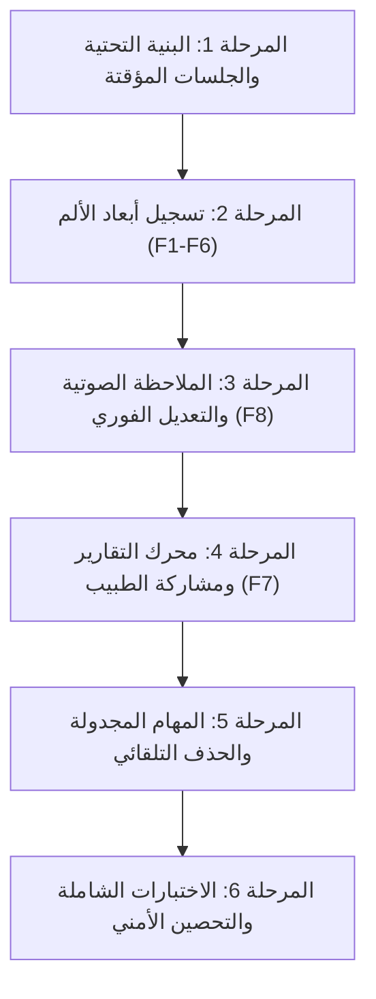

# PainVisual Backend Implementation Plan

## خطة تنفيذ الواجهة الخلفية (Backend Architecture & Execution Plan)
### مشروع: تطبيق الاستشارات الطبية — وصف الألم بالنموذج التفاعلي
**الشعار والموقف الإرغونومي:** «الألم يُرى ولا يُوصف بالكلمات»  
**الوثيقة:** الدليل الفني والتنفيذي لفريق ومطوري الواجهة الخلفية (Backend Team & AI Agent Manual)  
**الإصدار:** 1.0 — MVP نوفمبر 2026  
**المراجع الحاكمة:** [cahier_charge.md](file:///c:/Users/MO/Desktop/ai-drive/cahier_charge.md) | [architecture.md](file:///c:/Users/MO/Desktop/ai-drive/New%20files/architecture.md) | [api-contract.md](file:///c:/Users/MO/Desktop/ai-drive/New%20files/api-contract.md)

---

## 1. الهدف ونطاق العمل (Purpose & Scope)

تهدف هذه الوثيقة إلى تمكين فريق تطوير الواجهة الخلفية (أو وكلاء الـ AI المنفذين) من بناء وتشغيل وصيانة الخادم الخلفي لتطبيق **PainVisual** خطوة بخطوة، مع ضمان التطابق الكامل مع [api-contract.md](file:///c:/Users/MO/Desktop/ai-drive/New%20files/api-contract.md) واحترام قواعد العمل والخصوصية الصحية المحددة في [architecture.md](file:///c:/Users/MO/Desktop/ai-drive/New%20files/architecture.md).

### 1.1 المراجع الحاكمة المعتمدة (Sources of Truth)
- **عقد الـ API الملزم:** [api-contract.md](file:///c:/Users/MO/Desktop/ai-drive/New%20files/api-contract.md) (20 نقطة اتصال REST مع الغلاف القياسي).
- **قواعد المعمارية والبيانات:** [architecture.md](file:///c:/Users/MO/Desktop/ai-drive/New%20files/architecture.md) (نماذج الجلسات وسجلات الألم والتقارير).
- **الهيكل الإرغونومي والوظائف:** [cahier_charge.md](file:///c:/Users/MO/Desktop/ai-drive/cahier_charge.md) (الشاشات السبع، والوظائف F1 إلى F8).

---

## 2. نطاق المسؤولية البرمجية (Backend Team Ownership)

يمتلك فريق الواجهة الخلفية المسؤولية الكاملة عن المكونات التالية:
- شجرة مجلد الخادم: `backend/src/**` (مكتوب بلغة TypeScript على بيئة Node.js / Express).
- نماذج وقواعد البيانات: `backend/src/models/**` و `backend/src/prisma/**`.
- المهام المجدولة لإدارة البيانات المؤقتة: `backend/src/jobs/**`.
- محرك توليد وتصدير ملفات PDF السريرية: `backend/src/modules/report/pdfGenerator.ts`.
- اختبارات الخادم والتكامل: `backend/tests/**` (Unit & Integration Tests).
- تعريفات الأنواع المشتركة: `shared/types/**` بالتنسيق المتطابق مع الواجهة الأمامية.

> [!CAUTION]
> **قاعدة صارمة:** لا يُسمح لفريق الواجهة الخلفية بتعديل واجهات المستخدم (UI Screens) أو اختراع مسارات أو حقول غير موثقة في [api-contract.md](file:///c:/Users/MO/Desktop/ai-drive/New%20files/api-contract.md).

---

## 3. بيئة التشغيل والمكدس التقني (Runtime & Tech Stack)

```bash
# تشغيل خادم التطوير للواجهة الخلفية فقط
cd backend
npm run dev
```

### 3.1 المكونات التقنية المعتمدة
- **اللغة والبيئة:** Node.js 20+ LTS و TypeScript 5.4+ (نمط التحقق الصارم `strict: true`).
- **إطار العمل (Framework):** Express 4.19+ (أو Fastify 4+) مع دعم Async Middleware ومعالجة الأخطاء المركزية.
- **التحقق من البيانات (Validation):** مكتبة `Zod 3.23+` مطابقة تماماً للملحق (أ) في عقد الـ API.
- **قاعدة البيانات (Database):** PostgreSQL 15+ مدارة مع امتداد JSONB (عبر Prisma ORM) أو MongoDB 7+ (عبر Mongoose).
- **التخزين السحابي للملفات والصوت:** S3-Compatible Storage (AWS S3 أو Cloudflare R2 أو محلياً MinIO).
- **توليد الوثائق السريرية:** PDFKit أو Puppeteer Headless لتصيير رسومات المتجهات وخريطة التقرير البصري.
- **الأمان والتحصين:** Helmet, CORS, Express-Rate-Limit, Crypto (AES-256-GCM للرموز الحساسة).

---

## 4. القواعد الهندسية للواجهة الخلفية (Core Backend Rules)

1. **التحكم النحيف (Thin Controllers):** تقتصر المتحكمات على استلام الطلب، وتمرير البيانات لمخطط Zod للتحقق، واستدعاء الخدمة (Service)، ثم تغليف الاستجابة في الغلاف القياسي `{ success, data, error, meta }`.
2. **عزل قواعد الأعمال داخل الخدمات (Domain Services):** جميع العمليات الحسابية (مثل قياس متجهات انتشار الألم، ومطابقة التوقيت، وتجميع بيانات التقرير) تُنفذ داخل طبقة الـ Service حصراً.
3. **تطبيق الخصوصية بالبناء (Health Privacy by Design):** لا يتم حفظ أي أسماء أو هويات شخصية للمرضى؛ الجلسة مؤقتة وترتبط فقط بمعرف `sessionToken` عشوائي.
4. **الحذف الآمن للبيانات المؤقتة (Ephemeral TTL Lifecycle):** تحذف الجلسات غير المكتملة بعد 6 ساعات، وتُشطب التقارير ومرفقاتها بعد 48 ساعة بواسطة المهام المجدولة لحماية سرية المريض.
5. **مطابقة رموز الأخطاء (Contract Error Codes):** يجب أن تتطابق جميع رموز الأخطاء الصادرة عن الخادم بنسبة 100% مع الملحق (ب) في [api-contract.md](file:///c:/Users/MO/Desktop/ai-drive/New%20files/api-contract.md).

---

## 5. هيكلية مجلدات الواجهة الخلفية (Backend Folder Architecture)

```
backend/
├── src/
│   ├── config/                         # متغيرات البيئة وإعدادات الاتصال
│   │   ├── env.config.ts
│   │   ├── database.config.ts
│   │   └── storage.config.ts
│   ├── modules/                        # الوحدات الوظيفية المقسمة حسب النطاق
│   │   ├── session/                    # وحدة الجلسات المؤقتة
│   │   │   ├── session.routes.ts
│   │   │   ├── session.controller.ts
│   │   │   ├── session.service.ts
│   │   │   ├── session.model.ts
│   │   │   └── session.schema.ts
│   │   ├── painRecord/                 # وحدة قياس وتسجيل أبعاد الألم (F1-F6, F8)
│   │   │   ├── painRecord.routes.ts
│   │   │   ├── painRecord.controller.ts
│   │   │   ├── painRecord.service.ts
│   │   │   ├── painRecord.model.ts
│   │   │   └── painRecord.schema.ts
│   │   ├── audio/                      # وحدة الملاحظة الصوتية (45 ثانية)
│   │   │   ├── audio.routes.ts
│   │   │   ├── audio.controller.ts
│   │   │   ├── audio.service.ts
│   │   │   └── audio.validator.ts
│   │   ├── report/                     # وحدة تجميع وتصدير التقرير البصري (F7)
│   │   │   ├── report.routes.ts
│   │   │   ├── report.controller.ts
│   │   │   ├── report.service.ts
│   │   │   ├── report.model.ts
│   │   │   └── report.pdfGenerator.ts
│   │   ├── doctorAccess/               # وحدة بوابة استعراض الطبيب السريرية
│   │   │   ├── doctorAccess.routes.ts
│   │   │   ├── doctorAccess.controller.ts
│   │   │   └── doctorAccess.service.ts
│   │   └── system/                     # وحدة التحقق من الصحة وتكوين الأصول
│   │       ├── system.routes.ts
│   │       ├── system.controller.ts
│   │       └── system.service.ts
│   ├── jobs/                           # المهام المجدولة (Cron Jobs)
│   │   ├── abandonedSessions.job.ts    # حذف الجلسات المعلقة (> 6 ساعات)
│   │   └── expiredReports.job.ts       # حذف التقارير ومرفقاتها (> 48 ساعة)
│   ├── middlewares/                    # البرمجيات الوسيطة
│   │   ├── auth.middleware.ts          # التحقق من Bearer Session Token
│   │   ├── doctorAuth.middleware.ts    # التحقق من X-Doctor-Token
│   │   ├── validate.middleware.ts      # التحقق من المدخلات بواسطة Zod
│   │   ├── rateLimiter.middleware.ts   # حماية ضد التخمين والهجمات
│   │   └── errorHandler.middleware.ts  # التقاط الأخطاء المركزية وصياغتها
│   ├── utils/                          # الأدوات والمساعدات البرمجية
│   │   ├── crypto.util.ts              # توليد أكواد العيادة وتجزئة الرموز
│   │   ├── vectorMath.util.ts          # التحقق من إحداثيات السحب ومنحنيات بيزيير
│   │   └── responseFormatter.ts        # تشكيل الغلاف القياسي
│   ├── app.ts                          # إعداد Express والبرمجيات الوسيطة
│   └── server.ts                       # نقطة الإقلاع وربط المنافذ
├── tests/
│   ├── unit/
│   └── integration/
├── Dockerfile
├── package.json
└── tsconfig.json
```

---

## 6. تفصيل الوحدات البرمجية والمسؤوليات (Modules & Services Breakdown)

### 6.1 وحدة الجلسات المؤقتة (`session.module`)
- **المسؤولية:** تفعيل الشاشة 1 (Screen 1) عبر إنشاء الجلسة للمريض بنقرة واحدة، وإصدار رمز الجلسة `sessionToken` وتخزينه في جدول `sessions` مع وقت انتهاء أقصاه 6 ساعات للجلسات غير المكتملة.
- **المتطلبات المحققة:** بدء رحلة المستخدم وتأمين الخصوصية الصحية (Zero Patient Identifiers).
- **نقاط الاتصال المرتبطة:**
  - `POST /v1/sessions`
  - `GET /v1/sessions/:id`

### 6.2 وحدة تسجيل أبعاد الألم (`painRecord.module`)
- **المسؤولية:** إدارة وحفظ الحالات الهندسية والحسية للأبعاد الستة للألم في جدول `pain_records` ومطابقتها للشاشات 2، 3، 4، 5، و 6:
  - `location`: إحداثيات المواضع ($X, Y$)، العرض الأمامي أو الخلفي (F1).
  - `radiation`: مسار الانتشار، نقطة النهاية، ومعامل الانحناء (F2).
  - `intensity`: مستوى الشدة (1–10)، اللون الست عشري، وتدرج التلوين (F3).
  - `nature`: قائمة الرموز الحسية المرتبطة بكل موضع (F4).
  - `timing`: ساعات ظهور وذروة وتكرار الألم على الخط الزمني 24 ساعة (F5).
  - `movements`: شبكة الحركات الصعبة والوضعيات المحفزة المرتبطة بكل موضع (F6).
  - `dimension`: التعديل الفوري الرجعي بلمسة واحدة لأي بعد دون مسح بقية البيانات (F8).
- **نقاط الاتصال المرتبطة:**
  - `GET /v1/pain-records/:id`
  - `PUT /v1/pain-records/:id/location`
  - `PUT /v1/pain-records/:id/radiation`
  - `PUT /v1/pain-records/:id/intensity`
  - `PUT /v1/pain-records/:id/nature`
  - `PUT /v1/pain-records/:id/timing`
  - `PUT /v1/pain-records/:id/movements`
  - `PATCH /v1/pain-records/:id/dimension`

### 6.3 وحدة الملاحظة الصوتية (`audio.module`)
- **المسؤولية:** استقبال الملف الصوتي الثنائي الاختياري (Fulfilling the ergonomic trade-off: audio memo $\le 45$s)، والتأكد من صيغة الملف (`audio/webm` أو `audio/ogg`)، وضمان عدم تجاوزه لـ 45 ثانية وحجم 10 ميغابايت، وتخزينه مشفراً في مخزن S3 وإرجاع مفتاح التخزين `audioVaultId`.
- **نقاط الاتصال المرتبطة:**
  - `POST /v1/pain-records/:id/audio`
  - `DELETE /v1/pain-records/:id/audio`

### 6.4 وحدة التقرير البصري ومشاركته (`report.module`)
- **المسؤولية:** تجميع سجل الألم الكامل، وتوليد لقطة بصرية موحدة للتقرير، واستخراج مؤشرات ملخصة (مثل منطقة الألم الأكثر حدة وأوقات الذروة)، وتوليد رمز استشارة عيادي مميز من 6 خانات (مثل `PV-4981`) مع رمز QR، وتصيير ملف PDF سريري عالي الجودة للطباعة أو التنزيل (F7).
- **نقاط الاتصال المرتبطة:**
  - `POST /v1/reports/:recordId/generate`
  - `GET /v1/reports/:id`
  - `POST /v1/reports/:id/share`
  - `GET /v1/reports/:id/pdf`

### 6.5 وحدة بوابة الطبيب السريرية (`doctorAccess.module`)
- **المسؤولية:** معالجة كود العيادة المكون من 6 خانات أو قراءة رمز QR، والتحقق من عدم انتهاء صلاحية التقرير (48 ساعة)، ثم تزويد الطبيب بواجهة قراءة تفاعلية سريرية خالية من أدوات الرسم ومجهزة للاطلاع الفوري والاستماع للملاحظة الصوتية.
- **الأمان والقيود:** حظر أي عمليات تعديل (Read-Only) مع تطبيق محدد معدل الطلبات (Rate Limiting) بحد أقصى 5 محاولات خاطئة لكل دقيقة لمنع هجمات القوة الغاشمة (Brute Force).
- **نقاط الاتصال المرتبطة:**
  - `POST /v1/doctor/access`
  - `GET /v1/doctor/consultation/:token`

### 6.6 وحدة التشغيل والتكوين (`system.module`)
- **المسؤولية:** توفير نقطة فحص الجاهزية التشغيلية (Health Check) لربطها بأنظمة المراقبة، وتزويد الواجهة بقائمة الرموز الحسية والأيقونات المعيارية.
- **نقاط الاتصال المرتبطة:**
  - `GET /v1/health`
  - `GET /v1/system/config`

---

## 7. تصميم قاعدة البيانات ونماذج الوصول (Database Models & Access Layer)

سيتم استخدام بنية مستندات هجينة (Relational + JSONB في PostgreSQL عبر Prisma) أو مستندات MongoDB:

### 7.1 نموذج الجلسات (`Session`)
```prisma
model Session {
  id           String      @id @default(uuid())
  sessionToken String      @unique
  status       String      @default("in_progress") // in_progress | completed | expired
  deviceInfo   Json?
  createdAt    DateTime    @default(now())
  expiresAt    DateTime
  painRecord   PainRecord?

  @@index([sessionToken])
  @@index([expiresAt])
}
```

### 7.2 نموذج سجل أبعاد الألم (`PainRecord`)
```prisma
model PainRecord {
  id          String           @id @default(uuid())
  sessionId   String           @unique
  session     Session          @relation(fields: [sessionId], references: [id], onDelete: Cascade)
  locations   Json             @default("[]") // Array of PainLocationDTO
  timing      Json?            // TimingDTO (onsetHours, frequency, markers)
  movements   Json             @default("[]") // Array of MovementDTO
  audioMemo   Json?            // { hasAudio, durationSeconds, storageKey }
  createdAt   DateTime         @default(now())
  updatedAt   DateTime         @updatedAt
  report      ClinicalReport?

  @@index([sessionId])
}
```

### 7.3 نموذج التقارير السريرية (`ClinicalReport`)
```prisma
model ClinicalReport {
  id              String      @id @default(uuid())
  painRecordId    String      @unique
  painRecord      PainRecord  @relation(fields: [painRecordId], references: [id], onDelete: Cascade)
  clinicCode      String      @unique // e.g. "PV-4981"
  doctorShareHash String      @unique
  summary         Json        // Clinical highlights
  visualSnapshot  String?     // S3 URL or SVG data
  pdfUrl          String?     // S3 PDF asset path
  isLocked        Boolean     @default(false)
  createdAt       DateTime    @default(now())
  expiresAt       DateTime    // Default: createdAt + 48 hours

  @@index([clinicCode])
  @@index([expiresAt])
}
```

---

## 8. خطة مراحل التنفيذ الخلفي (Phase-by-Phase Execution Roadmap)

تنقسم خطة تنفيذ الواجهة الخلفية إلى **6 مراحل تسلسلية محكمة** تضمن اكتمال وبناء واختبار النظام بشكل تدريجي:



### المرحلة 1: إعداد الأساس التقني وإدارة الجلسات المؤقتة (Foundation & Sessions)
- **المخرجات:**
  1. تهيئة مشروع TypeScript وهيكل المجلدات وملف `tsconfig.json`.
  2. ربط قاعدة البيانات وإعداد migrations لنماذج `Session` و `PainRecord`.
  3. بناء البرمجيات الوسيطة المركزية: `errorHandler`, `responseFormatter`, `validateMiddleware`.
  4. تنفيذ خدمة ومتحكم الجلسات: `POST /v1/sessions` و `GET /v1/sessions/:id`.
  5. فحص الجاهزية: `GET /v1/health` و `GET /v1/system/config`.
- **معيار الاكتمال:** إمكانية إصدار رمز `sessionToken` صالح والتحقق منه في الطلبات التالية.

### المرحلة 2: محرك تسجيل أبعاد الألم والأجهزة الحسية (F1 إلى F6 Telemetry Engine)
- **المخرجات:**
  1. تطبيق مخططات التحقق (Zod Schemas) لإحداثيات اللمس والألوان والمتجهات (الملحق أ).
  2. تنفيذ endpoints الشاشات من 2 إلى 6:
     - `PUT /v1/pain-records/:id/location` (F1)
     - `PUT /v1/pain-records/:id/radiation` (F2)
     - `PUT /v1/pain-records/:id/intensity` (F3)
     - `PUT /v1/pain-records/:id/nature` (F4)
     - `PUT /v1/pain-records/:id/timing` (F5)
     - `PUT /v1/pain-records/:id/movements` (F6)
  3. توفير وظيفة استرجاع السجل الكامل: `GET /v1/pain-records/:id`.
- **معيار الاكتمال:** حفظ وتحديث وتكامل الأبعاد الستة بنجاح مع تسجيل زمني دقيق لكل تحديث.

### المرحلة 3: الملاحظة الصوتية والتعديل الفوري الرجعي (Voice Memo & In-Place Edit F8)
- **المخرجات:**
  1. إعداد وسيط استقبال الملفات (Multer Memory Storage) للتحقق من نوع وحجم الملف الصوتي.
  2. ربط خدمة التخزين السحابي المشفر لرفع وحذف المقاطع الصوتية (S3 / R2 Adapter).
  3. تنفيذ `POST /v1/pain-records/:id/audio` و `DELETE /v1/pain-records/:id/audio`.
  4. تنفيذ محرك التعديل الفوري الرجعي `PATCH /v1/pain-records/:id/dimension` (F8) لتمكين المريض من تعديل أي بعد بلمسة واحدة دون مساس ببقية الأبعاد.
- **معيار الاكتمال:** نجاح تسجيل وتخزين ملف صوتي مدته $\le 45$ ثانية، وتعديل شدة موضع معين وتأكيد تحديثه الفوري.

### المرحلة 4: مجمع التقرير البصري وتصدير الـ PDF وبوابة الطبيب (Report & Doctor Portal F7)
- **المخرجات:**
  1. خوارزمية تلخيص التقرير وحساب المؤشرات السريرية (أعلى شدة، منطقة الألم المركزية، أوقات الذروة).
  2. توليد رمز عيادة فريد مكون من 6 خانات (مثل `PV-4981`) وتوليد رمز QR مشفر.
  3. تنفيذ محرك تصدير ملف الـ PDF السريري المنظم وتوليد رابط تنزيله: `GET /v1/reports/:id/pdf`.
  4. تنفيذ بوابة الطبيب: `POST /v1/doctor/access` و `GET /v1/doctor/consultation/:token`.
- **معيار الاكتمال:** توليد تقرير كامل قابل للتنزيل كـ PDF صالح للطباعة، ودخول الطبيب عبر رمز الاستشارة وقراءة البيانات بنجاح في وضع القراءة فقط.

### المرحلة 5: المهام المجدولة والحذف الآمن للبيانات الصحية (Privacy & Lifecycle Jobs)
- **المخرجات:**
  1. إعداد جدولة المهام (عبر Node-Cron أو BullMQ).
  2. تنفيذ مهمة `abandonedSessions.job.ts`: مسح الجلسات غير النشطة بعد 6 ساعات.
  3. تنفيذ مهمة `expiredReports.job.ts`: شطب التقارير والملاحظات الصوتية بعد 48 ساعة من مشاركتها.
  4. إضافة سجلات التدقيق الأمنية الخالية من المعرفات الشخصية (Anonymized Audit Logs).
- **معيار الاكتمال:** تشغيل المهام تلقائياً والتأكد من تنظيف السجلات المنتهية دون ترك ملفات معلقة في مخزن الملفات.

### المرحلة 6: الاختبارات الآلية والتحصين الأمني (Testing & Security Hardening)
- **المخرجات:**
  1. كتابة اختبارات الوحدة (Unit Tests) للخدمات وخوارزميات معالجة المتجهات.
  2. كتابة اختبارات التكامل (Integration Tests) لنقاط الاتصال العشرين عبر `Supertest`.
  3. تطبيق تحصينات الأمان: تفعيل Helmet، وضبط CORS الصارم، وتقييد معدل الطلبات (Rate Limiting) على مسار دخول الأطباء.
  4. تجهيز ملف `Dockerfile` الخفيف للنشر السحابي.
- **معيار الاكتمال:** نجاح جميع الاختبارات بنسبة تغطية تتجاوز 85% وخلو الفحص الأمني من أي ثغرات.

---

## 9. استراتيجية الاختبارات والتحقق (Backend Testing Strategy)

| نوع الاختبار | النطاق والمكتبة المستخدمة | الهدف ومعيار النجاح |
|---|---|---|
| **Unit Tests** | `Jest` / `Vitest` | اختبار دوال التحقق، حساب متجهات الانتشار، وتوليد أكواد العيادة عشوائياً بدون تكرار. |
| **Contract Tests** | `Supertest` + `Zod` | اختبار مطابقة كل استجابة للغلاف القياسي ونماذج DTO في [api-contract.md](file:///c:/Users/MO/Desktop/ai-drive/New%20files/api-contract.md). |
| **Integration Tests** | قاعدة بيانات اختبارية مؤقتة (In-Memory / Docker Testcontainer) | محاكاة رحلة المريض الكاملة من الشاشة 1 إلى الشاشة 7 وتوليد التقرير ودخول الطبيب. |
| **Security Tests** | `OWASP ZAP` ومحاكاة الهجمات | التأكد من صد هجمات التخمين على أكواد العيادة، ورفض الملفات الصوتية المشبوهة أو الزائدة عن الحد. |

---

## 10. خطة تسليم الواجهة الأمامية (Frontend Handoff Agreement)

لضمان عمل فريقي الواجهة والخلفية بالتوازي وبدون أي تعارض:
1. **البيئة الموكية (Mock Server):** يوفر فريق الواجهة الخلفية خادم اختبار سريع مطابق لنماذج [api-contract.md](file:///c:/Users/MO/Desktop/ai-drive/New%20files/api-contract.md) بحيث يبدأ فريق الواجهة الأمامية فوراً بربط الشاشات السبع.
2. **تسليم الوحدات المنتهية:** بمجرد انتهاء كل مرحلة من مراحل الخطة، يتم تسليم:
   - قائمة نقاط الاتصال الجاهزة.
   - كود استشارة تجريبي صالح للاختبار الفوري (مثل `PV-TEST1`).
   - ملفات الأنواع المحدثة في مجلد `shared/types`.

---

> **خاتمة:**  
> تضمن هذه الخطة الهندسية بناء خادم خلفي عالي الأداء، يحترم أبعاد الألم الستة، ويلتزم التزاماً صارماً بالموقف الإرغونومي والحدود السريرية المنصوص عليها في [cahier_charge.md](file:///c:/Users/MO/Desktop/ai-drive/cahier_charge.md). وهي جاهزة للتنفيذ المباشر لتوجيه المراحل اللاحقة.
