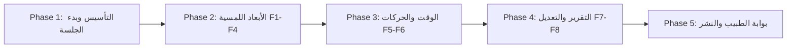

# PainVisual Master Development Plan

## خطة التنفيذ والتطوير الرئيسية الشاملة (Master Implementation & Execution Plan)
### مشروع: تطبيق الاستشارات الطبية — وصف الألم بالنموذج التفاعلي
**الشعار والموقف الإرغونومي:** «الألم يُرى ولا يُوصف بالكلمات»  
**الوثيقة:** خطة التنسيق والتكامل الرئيسية بين الواجهة والخلفية والبنية التحتية (Master Plan)  
**الإصدار:** 1.0 — MVP نوفمبر 2026  
**المراجع الحاكمة المعتمدة:**
- [cahier_charge.md](file:///c:/Users/MO/Desktop/ai-drive/cahier_charge.md) (الهيكل والتنظيم، الشاشات السبع، الوظائف F1–F8)
- [architecture.md](file:///c:/Users/MO/Desktop/ai-drive/New%20files/architecture.md) (المعمارية المرجعية وقواعد التصميم)
- [api-contract.md](file:///c:/Users/MO/Desktop/ai-drive/New%20files/api-contract.md) (عقد واجهات الـ REST العشرين)
- [backend-plan.md](file:///c:/Users/MO/Desktop/ai-drive/New%20files/backend-plan.md) (خطة تنفيذ الخادم وقواعد البيانات)
- [frontend-plan.md](file:///c:/Users/MO/Desktop/ai-drive/New%20files/frontend-plan.md) (خطة تنفيذ الشاشات اللمسية ومحرك التفاعل)
- [infra-plan.md](file:///c:/Users/MO/Desktop/ai-drive/New%20files/infra-plan.md) (خطة النشر السحابي والخصوصية المؤقتة)

---

## فهرس المحتويات (Table of Contents)

1. [المبادئ التوجيهية لخطة التنفيذ (Guiding Principles)](#1-المبادئ-التوجيهية-لخطة-التنفيذ-guiding-principles)
2. [المخطط الزمني المقترح وفرق العمل (Estimated Timeline & Team Sizing)](#2-المخطط-الزمني-المقترح-وفرق-العمل-estimated-timeline--team-sizing)
3. [مراحل التنفيذ التسلسلية الخمس (Detailed Implementation Phases)](#3-مراحل-التنفيذ-التسلسلية-الخمس-detailed-implementation-phases)
   - [المرحلة 1: التأسيس وإدارة الجلسات المؤقتة (Foundation & Session Lifecycle)](#المرحلة-1-التأسيس-وإدارة-الجلسات-المؤقتة-foundation--session-lifecycle)
   - [المرحلة 2: محرك قياس وتلوين أبعاد الألم (Spatial & Sensation Telemetry F1–F4)](#المرحلة-2-محرك-قياس-وتلوين-أبعاد-الألم-spatial--sensation-telemetry-f1f4)
   - [المرحلة 3: الإيقاع الزمني والوضعيات الحركية (Temporal Rhythm & Postures F5–F6)](#المرحلة-3-الإيقاع-الزمني-والوضعيات-الحركية-temporal-rhythm--postures-f5f6)
   - [المرحلة 4: التقرير البصري والتعديل الفوري والصوت (Report, Mutation & Audio F7–F8)](#المرحلة-4-التقرير-البصري-والتعديل-الفوري-والصوت-report-mutation--audio-f7f8)
   - [المرحلة 5: بوابة الطبيب ومشاركة التقرير والنشر (Doctor Portal, Sharing & Cloud Launch)](#المرحلة-5-بوابة-الطبيب-مشاركة-التقرير-والنشر-doctor-portal-sharing--cloud-launch)
4. [بروتوكول المصافحة والتسليم بين الفرق (Cross-Team Handshake Protocol)](#4-بروتوكول-المصافحة-والتسليم-بين-الفرق-cross-team-handshake-protocol)
5. [مصفوفة تتبع المتطلبات وتكامل المراحل (Master Traceability Matrix)](#5-مصفوفة-تتبع-المتطلبات-وتكامل-المراحل-master-traceability-matrix)
6. [إدارة المخاطر وخطط الطوارئ (Risk Management & Fallback Strategies)](#6-إدارة-المخاطر-وخطط-الطوارئ-risk-management--fallback-strategies)

---

## 1. المبادئ التوجيهية لخطة التنفيذ (Guiding Principles)

- **الالتزام المطلق بعقد الـ API (Contract-First Discipline):** يُمنع منعاً باتاً كتابة أي كود برمجي ينحرف عن الحقول أو الغلاف الموحد في [api-contract.md](file:///c:/Users/MO/Desktop/ai-drive/New%20files/api-contract.md). تعمل الواجهة الأمامية بموكات مطابقة للعقد حتى اكتمال نقاط الاتصال.
- **التسليم التدريجي الآمن (Incremental Delivery):** كل مرحلة تُنتج مخرجات قابلة للفحص والتجربة المباشرة؛ لا يوجد شيء يسمى "دمج اللحظة الأخيرة (Big-Bang Integration)".
- **الفصل التام للمسؤوليات (Strict Separation of Concerns):**
  - الواجهة الخلفية تمتلك: قواعد الأعمال، تخزين البيانات، تشفير الجلسات، التحقق، وتوليد ملفات PDF.
  - الواجهة الأمامية تمتلك: التفاعل اللمسي، تجسيد مجسم الجسم، وتحديثات الـ 60fps اللحظية.
- **شرط المصافحة الإلزامي (Mandatory Handshake Gate):** لا يُسمح بإغلاق أي مرحلة أو الانتقال للمرحلة التالية إلا بعد إجراء فحص تكاملي ناجح ومصادقة مشتركة بين الواجهة والخلفية.

---

## 2. المخطط الزمني المقترح وفرق العمل (Estimated Timeline & Team Sizing)

وفقاً للجدول الزمني المقترح في [cahier_charge.md](file:///c:/Users/MO/Desktop/ai-drive/cahier_charge.md#L125) (فترة تطوير إجمالية تتراوح بين 10 إلى 13 يوماً عمل لفريق مصغر من مطور واجهة + مطور خلفية):

| المرحلة | التركيز الوظيفي | أيام الخلفية | أيام الواجهة | أيام التكامل والاختبار | إجمالي الأيام |
|---|---|:---:|:---:|:---:|:---:|
| **المرحلة 1** | التأسيس، بيئة التشغيل، والجلسات (Screen 1) | 2 | 2 | 0.5 | 2.5 يوم |
| **المرحلة 2** | أبعاد الألم اللمسية (Screens 2, 3, 4, 5 — F1–F4) | 3 | 3 | 1.0 | 4.0 أيام |
| **المرحلة 3** | الخط الزمني والحركات (Screen 6 — F5, F6) | 1.5 | 1.5 | 0.5 | 2.0 يوم |
| **المرحلة 4** | التقرير البصري، التعديل الفوري، والصوت (Screen 7 — F7, F8) | 2 | 2 | 0.5 | 2.5 يوم |
| **المرحلة 5** | بوابة الطبيب، المشاركة، والنشر السحابي | 1.5 | 1.5 | 0.5 | 2.0 يوم |
| **الإجمالي** | **مشروع PainVisual MVP المكتمل** | **10 أيام** | **10 أيام** | **3 أيام** | **13 يوم عمل** |

---

## 3. مراحل التنفيذ التسلسلية الخمس (Detailed Implementation Phases)

---

### المرحلة 1: التأسيس وإدارة الجلسات المؤقتة (Foundation & Session Lifecycle)

**الهدف:** إطلاق بيئة العمل المشتركة، وتهيئة قاعدة البيانات، وتنفيذ تدفق الشاشة الأولى (Screen 1) بتمكين المريض من بدء جلسة جديدة بنقرة واحدة والحصول على رمز جلسة مشفر.

#### أ. مهام الواجهة الخلفية (Backend Tasks):
- تهيئة خادم Express و TypeScript وتجهيز البرمجيات الوسيطة (`errorHandler`, `responseFormatter`, `validateMiddleware`).
- إنشاء نماذج قاعدة البيانات الأولية: `Session` و `PainRecord` عبر Prisma/PostgreSQL.
- تنفيذ نقاط الاتصال:
  - `POST /v1/sessions` (إنشاء جلسة وإرجاع `sessionToken` بمدة صلاحية 6 ساعات).
  - `GET /v1/sessions/:id` (التحقق من حالة الجلسة).
  - `GET /v1/health` و `GET /v1/system/config`.

#### ب. مهام الواجهة الأمامية (Frontend Tasks):
- تهيئة مشروع Vite + React 19 + Tailwind CSS ومكتبة Lucide-React.
- إعداد عميل الاتصال الموحد `apiClient.ts` ومخزن الحالة الأساسي `usePainSessionStore.ts`.
- بناء الشاشة الأولى `Screen1_Welcome.tsx` متضمنة الشعار «الألم يُرى ولا يُوصف بالكلمات»، ومفتاح تبديل اللغة (عربي/فرنسي)، وزر **«بدء الوصف»** بارتفاع 60px.

#### ج. مهام البنية التحتية (Infra Tasks):
- إعداد طبولوجيا التطوير المحلي وتهيئة اتصال قاعدة البيانات PostgreSQL على المنفذ 5432.

#### د. نقطة فحص المصافحة (Handshake Checkpoint 1):
- [x] النقر على «بدء الوصف» في الواجهة يرسل طلباً حقيقياً إلى `POST /v1/sessions`.
- [x] يُسجل الخادم الجلسة في قاعدة البيانات ويُرجع رمز جلسة صالح `sessionToken`.
- [x] يُخزن الرمز في حالة العميل ويتم الانتقال السلس إلى الشاشة 2.

---

### المرحلة 2: محرك قياس وتلوين أبعاد الألم (Spatial & Sensation Telemetry F1–F4)

**الهدف:** بناء جوهر التفاعل البصري واللمسي؛ تمكين المريض من تحديد مواضع الألم (F1)، وسحب مسار الانتشار (F2)، وتلوين الشدة بتدرج لوني (F3)، وإسقاط رموز طبيعة الألم (F4) عبر الشاشات 2، 3، 4، و 5.

#### أ. مهام الواجهة الخلفية (Backend Tasks):
- تطبيق مخططات Zod الصارمة للتحقق من الإحداثيات النسبية `(x, y)` وقيم الشدة (1-10) وأكواد الألوان الست عشرية.
- تنفيذ نقاط الاتصال للأبعاد الأربعة:
  - `PUT /v1/pain-records/:id/location` (F1)
  - `PUT /v1/pain-records/:id/radiation` (F2)
  - `PUT /v1/pain-records/:id/intensity` (F3)
  - `PUT /v1/pain-records/:id/nature` (F4)
  - `GET /v1/pain-records/:id` (استرجاع السجل المحدث).

#### ب. مهام الواجهة الأمامية (Frontend Tasks):
- **الشاشة 2 (`Screen2_Location.tsx` - F1):** مسطح الجسم التشريحي (SVG Map)، زر التبديل «أمامي/خلفي»، دعم النقر المتعدد وإلغاء النقاط بلمسة ثانية.
- **الشاشة 3 (`Screen3_Radiation.tsx` - F2):** طبقة سحب متجهات الانتشار (Bézier Curve) وزر التخطي «الألم في مكانه ولا يمتد».
- **الشاشة 4 (`Screen4_Intensity.tsx` - F3):** طبقة التلوين اللمسي (تدرج شعاعي دافئ من الفاتح إلى الداكن) مع شريط تمرير تناظري.
- **الشاشة 5 (`Screen5_Nature.tsx` - F4):** صينية الرموز الخمسة (وخز، حرقان، نبض، طعن، ثقل) مع دعم السحب والإفلات التلقائي على الموضع (Snap-to-Pin).

#### ج. نقطة فحص المصافحة (Handshake Checkpoint 2):
- [x] تحديد موضع على الجسم الأمامي والخلفي يُحفظ بإحداثيات نسبية دقيقة.
- [x] سحب سهم الانتشار يُخزن متجه المسار في الخلفية ويُعاد رسمه بدقة عند الاسترجاع.
- [x] تغيير لون الشدة ينعكس على السجل برمز لوني مطابق للمواصفات.
- [x] الرموز المسحوبة تُربط بالموضع الصحيح وتظهر في استجابة `GET /v1/pain-records/:id`.

---

### المرحلة 3: الإيقاع الزمني والوضعيات الحركية (Temporal Rhythm & Postures F5–F6)

**الهدف:** تنفيذ الشاشة السادسة (Screen 6) لدمج التوقيت اليومي لظهور الألم وتكراره، وربطه بالوضعيات والحركات الصعبة المحفزة للألم.

#### أ. مهام الواجهة الخلفية (Backend Tasks):
- إنشاء خدمة معالجة التوقيت والتحقق من صحة ساعات اليوم ($0 \le \text{hour} \le 23$).
- تنفيذ نقاط الاتصال:
  - `PUT /v1/pain-records/:id/timing` (F5 - ساعات الظهور ونمط التكرار).
  - `PUT /v1/pain-records/:id/movements` (F6 - شبكة الحركات ومستويات صعوبتها).

#### ب. مهام الواجهة الأمامية (Frontend Tasks):
- **مكون الخط الزمني (`DayClockTimeline.tsx` - F5):** قرص أو شريط 24 ساعة مقسم بصرياً (صباح، ظهيرة، مساء، ليل) مع مؤشرات لمسية سهلة السحب.
- **مكون الحركات والوضعيات الصعبة (`MovementSelector.tsx` - F6):** شبكة أيقونات حركية لأجساد في وضعيات (انحناء، رفع ذراع، مشي، جلوس، التواء الجذع) تُرتبط بالموضع المتأثر بنقرة واحدة.

#### ج. نقطة فحص المصافحة (Handshake Checkpoint 3):
- [x] سحب علامات الوقت يحفظ أوقات الذروة في السجل.
- [x] اختيار حركة الانحناء مثلاً يربطها بموضع أسفل الظهر مع حفظ مستوى الشدة (severe/moderate).
- [x] الانتقال التلقائي السلس إلى الشاشة السابعة (Screen 7).

---

### المرحلة 4: التقرير البصري والتعديل الفوري والصوت (Report, Mutation & Audio F7–F8)

**الهدف:** إنجاز الشاشة السابعة (Screen 7) وتجميع أبعاد الألم الستة في بطاقة تقرير بصري موحدة للطبيب، مع تمكين المريض من التعديل الفوري بلمسة واحدة (F8) وتسجيل ملاحظة صوتية موجزة (45 ثانية).

#### أ. مهام الواجهة الخلفية (Backend Tasks):
- بناء خدمة تجميع وتلخيص التقرير (`report.service.ts` - F7) واستخراج المؤشرات السريرية البارزة.
- تنفيذ محرك التعديل الفوري الرجعي `PATCH /v1/pain-records/:id/dimension` (F8) لتحديث أي بعد دون مساس ببقية الأبعاد.
- إعداد وسيط استقبال وتخزين الملاحظة الصوتية (`POST /v1/pain-records/:id/audio`) بحد أقصى 45 ثانية وحجم 10 ميغابايت، وتخزينها مشفرة في مخزن S3/MinIO.

#### ب. مهام الواجهة الأمامية (Frontend Tasks):
- **بطاقة الملخص البصري (`VisualReportCard.tsx` - F7):** لوحة تجميعية شاملة لخريطة الجسم، الأسهم، الألوان، الرموز، وأوقات الذروة.
- **أزرار التعديل الفوري (`QuickEditButtons.tsx` - F8):** أيقونات تعديل بجانب كل بعد تعيد المريض للشاشة المطلوبة مباشرة مع زر «العودة للتقرير» بنقرة واحدة.
- **مسجل الصوت اللمسي (`AudioRecorderWidget.tsx`):** زر ميكروفون دائري مع عداد تنازلي 45 ثانية ومؤشر موجي يدعم الاستماع وإعادة التسجيل.

#### ج. نقطة فحص المصافحة (Handshake Checkpoint 4):
- [x] استدعاء `POST /v1/reports/:recordId/generate` ينتج ملخصاً بصرياً دقيقاً مطابقاً للمدخلات.
- [x] النقر على «تعديل الشدة» في الشاشة 7 يعيد المريض للشاشة 4، وتعديل اللون وتأكيده يحدث التقرير فوراً عبر `PATCH /dimension`.
- [x] تسجيل صوتي لمدة 30 ثانية يُرفع بنجاح ويُخزن في المخزن السحابي وتظهر علامته في التقرير.

---

### المرحلة 5: بوابة الطبيب ومشاركة التقرير والنشر (Doctor Portal, Sharing & Cloud Launch)

**الهدف:** تمكين الطبيب من قراءة التقرير فورياً عبر رمز استشارة عيادي من 6 خانات أو عبر رمز QR، وتصدير ملف PDF سريري عالي الدقة، وتفعيل مهام الحذف التلقائي للبيانات لحماية الخصوصية الصحية، والنشر السحابي النهائي.

#### أ. مهام الواجهة الخلفية (Backend Tasks):
- توليد كود عيادة مميز من 6 خانات (مثل `PV-4981`) ورابط استعراض سريري آمن.
- تنفيذ بوابة الطبيب: `POST /v1/doctor/access` و `GET /v1/doctor/consultation/:token`.
- بناء محرك توليد وتنزيل وثيقة الـ PDF السريرية (`GET /v1/reports/:id/pdf`).
- تفعيل المهام المجدولة (Cron Jobs): حذف الجلسات المعلقة (> 6 ساعات) وإتلاف التقارير المنتهية ومرفقاتها الصوتية (> 48 ساعة).
- تحصين الأمان: تحديد معدل الطلبات (Rate Limiting) على مدخل الطبيب، وتفعيل ترويسات Helmet الصارمة.

#### ب. مهام الواجهة الأمامية (Frontend Tasks):
- **نافذة المشاركة السريرية (`ShareModal.tsx`):** عرض رمز العيادة البارز ورمز QR للطبيب، وزر تنزيل الـ PDF.
- **بوابة الطبيب السريرية (`DoctorPortalView.tsx`):** واجهة قراءة بيضاء نظيفة ومخصصة للطبيب خالية من أدوات الرسم، تلخص الحالة السريرية وتتيح الاستماع للتسجيل الصوتي والطباعة الورقية.

#### ج. مهام البنية التحتية والنشر السحابي (Infra Tasks):
- بناء حاوية Docker الخفيفة ونشر الواجهة الخلفية على Render / Fly.io.
- نشر الواجهة الأمامية كـ PWA متجاوبة على Vercel / Cloudflare Pages.
- ضبط نطاقات النظام الرسمية وشهادات الأمان TLS 1.3 وسجلات المراقبة الخالية من الهويات الصحية.

#### د. نقطة فحص المصافحة (Handshake Checkpoint 5):
- [x] المريض يشارك التقرير ويظهر له الرمز `PV-4981` ورمز الـ QR.
- [x] الطبيب يدخل الرمز في بوابة الأطباء وتفتح له خريطة الألم السريرية في وضع القراءة فقط.
- [x] الطبيب يستمع للملاحظة الصوتية ويقوم بتنزيل تقرير الـ PDF المنسق بنجاح.
- [x] التأكد من عمل مهمة الحذف التلقائي لشطب السجلات منتهية الصلاحية.

---

## 4. بروتوكول المصافحة والتسليم بين الفرق (Cross-Team Handshake Protocol)

لضمان سلامة التنفيذ وتجنب أي أخطاء تكامل:
1. **عقد الـ API هو الحكم:** عند حدوث أي خلاف، يُعد [api-contract.md](file:///c:/Users/MO/Desktop/ai-drive/New%20files/api-contract.md) هو المرجع الإلزامي والنهائي؛ لا يجوز تعديل أي كود أو مسار إلا بعد تحديث الوثيقة باتفاق الفريقين.
2. **بروتوكول تسليم الواجهة الأمامية:**
   - يوفر فريق الخلفية استجابات اختبارية (Seed Data) ونموذج تقرير تجريبي جاهز (مثل `PV-TEST1`).
   - يتأكد فريق الواجهة من أن جميع الأزرار اللمسية تعمل بدقة وتستجيب للأخطاء بطريقة بصرية إنسانية.
3. **معيار الاعتماد النهائي (Phase Sign-off):** لا تُعتبر أي مرحلة منتهية إلا بعد اكتمال قائمة التدقيق (Checklist) الخاصة بها في قسم فحص المصافحة وتمرير اختبارات التكامل الآلية.

---

## 5. مصفوفة تتبع المتطلبات وتكامل المراحل (Master Traceability Matrix)

| المتطلب في دفتر الشروط | الوصف الإرغونومي والوظيفي | مرحلة التنفيذ | المكون في الواجهة | الخدمة في الخلفية |
|---|---|:---:|---|---|
| **F1** | مكان الألم، أمامي/خلفي، وتعدد المواضع | المرحلة 2 | `Screen2_Location.tsx` | `PUT /v1/pain-records/:id/location` |
| **F2** | مسار وسهم انتشار الألم المتدرج | المرحلة 2 | `Screen3_Radiation.tsx` | `PUT /v1/pain-records/:id/radiation` |
| **F3** | تلوين الموضع وشدة الألم التدريجية | المرحلة 2 | `Screen4_Intensity.tsx` | `PUT /v1/pain-records/:id/intensity` |
| **F4** | رموز طبيعة الألم الخمسة مع السحب والإفلات | المرحلة 2 | `Screen5_Nature.tsx` | `PUT /v1/pain-records/:id/nature` |
| **F5** | قرص الخط الزمني 24 ساعة لوقت الظهور | المرحلة 3 | `DayClockTimeline.tsx` | `PUT /v1/pain-records/:id/timing` |
| **F6** | شبكة الحركات الصعبة والوضعيات المحفزة | المرحلة 3 | `MovementSelector.tsx` | `PUT /v1/pain-records/:id/movements` |
| **F7** | توليد التقرير البصري ومراجعته وحفظه | المرحلة 4 | `VisualReportCard.tsx` | `POST /v1/reports/:id/generate` |
| **F8** | التعديل الفوري الرجعي بلمسة واحدة | المرحلة 4 | `QuickEditButtons.tsx` | `PATCH /v1/pain-records/:id/dimension` |
| **التنازل الإرغونومي** | الملاحظة الصوتية الاختيارية (45 ثانية) | المرحلة 4 | `AudioRecorderWidget.tsx`| `POST /v1/pain-records/:id/audio` |
| **بوابة الطبيب** | مشاركة التقرير بكود العيادة ورمز QR | المرحلة 5 | `DoctorPortalView.tsx` | `POST /v1/doctor/access` |
| **الخصوصية الصحية** | حذف البيانات المؤقتة بعد 6 و 48 ساعة | المرحلة 5 | حماية الجلسات المحلية | مهام الحذف التلقائي `cron-jobs` |

---

## 6. إدارة المخاطر وخطط الطوارئ (Risk Management & Fallback Strategies)

| الخطر المحتمل | مستوى الأثر | إجراء الحماية والوقاية المعتمد |
|---|:---:|---|
| ارتباك المريض أثناء سحب انتشار الألم | متوسط | توفير زر لمسي مباشر وبارز: «الألم في مكانه ولا يمتد» لتخطي الخطوة فوراً. |
| انقطاع اتصال الإنترنت في غرفة الانتظار | عالي | حفظ خريطة الألم وبياناتها محلياً في مخزن Zustand و `IndexedDB` دون فقدان أي مدخل. |
| بطء تحميل رسومات الجسم على الهواتف الضعيفة | متوسط | تضمين ملفات الـ SVG التشريحية مسبقاً (Inline SVGs) داخل حزمة التطبيق الأساسية لتعمل دون انتظار. |
| محاولة تخمين كود العيادة المكون من 6 خانات | عالي | تطبيق محدد معدل الطلبات (Rate Limiter) بحد أقصى 5 محاولات خاطئة لكل دقيقة وتوليد كود عشوائي مشفر. |
| إرسال ملفات صوتية طويلة أو غير متوافقة | منخفض | إيقاف التسجيل الصوتي قسرياً بعد 45 ثانية والتحقق من حجم ونوع الملف في الواجهة والخلفية. |

---

> **خاتمة:**  
> يمثل هذا المخطط الدليل التنفيذي الشامل والموحد لتحويل متطلبات تطبيق **PainVisual** إلى واقع برمجي ملموس، وفق مراحل هندسية متسلسلة تضمن الجودة الفائقة، الأمان الصحي، والوفاء بالموقف الإرغونومي الأصيل «الألم يُرى ولا يُوصف بالكلمات».
